# 实验3：软件架构与界面设计

## 学习通提交说明

- **提交平台：** 只向学习通对应的“实验报告”作业上传一份PDF文件。
- **文件命名：** 班级-学号-姓名-实验3-软件架构与界面设计.pdf。
- **PDF内容：** 需求与设计对应表、技术选型与架构决策、软件与外部环境关系图、总体架构图与模块说明、数据与接口设计、核心流程图、关键界面原型、设计检查记录及仓库版本证据。
- **截止时间：** 以学习通作业设置为准；报告中的仓库链接与 Commit 用于过程核验。

## 1. 实验目的

- 把实验2的需求说明转化为可指导后续开发的软件架构、模块边界、数据模型、接口和交互方案。
- 形成与个人能力匹配的技术选型，并保留关键决策依据。
- 完成关键设计，检查需求、架构与界面之间是否一致，为实验4的软件基础功能开发提供设计基线。

## 2. 实验内容

### 2.1 需求输入与设计范围

- 从实验2中选定一条核心用户流程，列出该流程对应的用户故事、功能需求、非功能需求和验收条件，作为本次设计的输入。
- 运用软件工程课程中学习的双向追踪原则，先建立“需求编号—准备完成的设计内容—对应图或文档”对应表，确保每项核心需求都有后续设计任务，后续也能从设计内容追溯到需求来源。
- 初步划分普通软件功能与AI功能的边界，说明哪些任务可以由确定的程序逻辑完成，哪些任务准备交给LLM处理，以及哪些结果需要程序校验或用户确认。本阶段不要求确定RAG、Agent等具体实现方法。

### 2.2 技术选型与架构决策

- 结合已学习的程序设计语言和软件设计约束，从本人熟悉程度、实现成本、框架生态、AI接入、测试和运行环境等方面比较候选方案。比较可以使用简单表格，不要求罗列过多技术或原因。
- 对开发语言与框架、数据保存方式、软件体系结构风格等关键选择编写简短的设计决策说明。设计决策说明也称架构决策记录（ADR），只需写清要解决的问题、考虑过的方案、最终选择、理由和可能的不足。
- 为一项可能影响项目继续开发的关键依赖准备替代方案，例如模型服务、数据库或主要框架。

### 2.3 软件架构与模块设计

- 绘制软件与外部环境关系图（也称简化的系统上下文图），标出用户、个人软件、模型或模型服务以及项目需要访问的外部系统或数据源，说明哪些内容属于本软件、哪些属于外部依赖。模型应根据实际运行和调用方式放在合适位置，并注明使用本地模型还是云端模型服务。图形可以参考已经学习的数据流图，用简单的方框和带名称的箭头表示。
- 绘制软件总体架构图和模块结构图，根据项目特点选择已学习的分层、MVC等体系结构风格，并可使用包图或构件图表示界面、业务、数据和AI能力等模块。两张图可以合并，但要写明各模块的职责和依赖关系。
- 在总体架构图中标明主要数据、调用方向或交互关系，并制作“用户—普通程序—模型—工具职责划分表”，说明核心流程中每一方负责什么以及由谁检查AI结果。

### 2.4 数据、接口与核心流程设计

- 使用已经学习的类图、ER图或其他合适的图形描述核心数据，说明主要数据对象、关键字段、约束和关系，并标明需要保存的数据和敏感数据。
- 设计支撑核心用户流程的主要接口，说明接口由哪个模块提供、由谁调用、用途、输入、输出和失败情况，并至少给出一个正常调用与错误调用示例。
- 选择已经学习的顺序图、活动图、状态图或普通流程图，描述一次核心任务从用户输入到结果反馈的过程，包含正常路径、失败处理以及必要的人工确认点。

### 2.5 界面原型与交互设计

- 绘制页面结构图、导航关系图或顺序图，说明用户如何从软件入口进入核心功能，以及如何在页面之间跳转、返回、退出或重新操作。
- 完成不少于3张关键界面原型图，至少包括首页或入口页、核心任务页和结果页。界面原型是编码前的页面草图，用于确定页面上显示什么以及怎样操作，不要求编写前端代码，可以使用Figma、墨刀、Axure等工具，也可以使用清晰的**手绘图**。
- 结合已经学习的静态元素、动态元素、用户输入元素和用户命令元素，在原型中标注主要信息、输入区域、按钮、输入限制和操作反馈，并补充与项目有关的加载、空数据、错误、重新操作或人工确认状态。

### 2.6 设计一致性检查与版本保存

- 完善2.1建立的需求与设计对应表，补充“架构模块—数据或接口—界面—验收条件”等内容，逐项检查实验2中的核心需求是否已经落实，不需要重新制作一张内容重复的表格。
- 记录检查范围、发现的问题和设计调整；如果未发现问题，应说明检查依据。将架构图、数据模型图、流程图、界面原型图和其他设计文件保存到个人GitHub/Gitee仓库并提交。

## 3. 操作记录

### 3.1 需求输入与设计范围（对应 2.1）

#### 3.1.1 设计对象与 AI 边界

本次只围绕本学期唯一重点流程设计：

> 启动对局 → 截取**游戏窗口区域** → 按提示强度档位工作（默认“仅复盘”，游玩时不介入）→ 记录**局面／建议／玩家实际操作／结果** → 输出逐回合复盘报告。

**AI 边界（结论）**：判断权归模型，**放行权归规则**，最终决定权归玩家——模型只做“看不懂就说不懂”的语义判断，合法性校验、重试次数、记录与统计一律由规则程序完成。

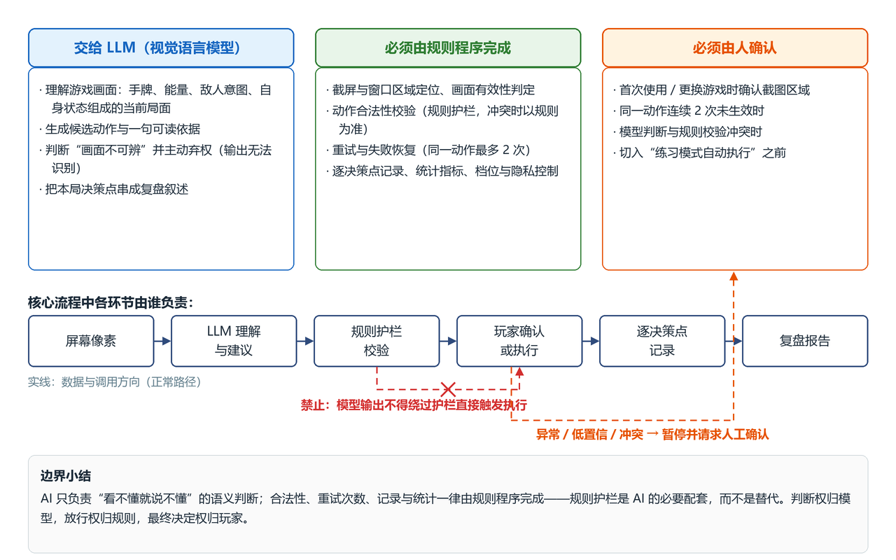

图 1　AI 与普通程序的职责边界：上栏三列分别为**交给 LLM**、**必须由规则程序完成**、**必须由人确认**的事项；下栏为一次决策中各环节的负责方，红色为“模型不得绕过护栏直接触发执行”的禁止路径，橙色虚线为异常转人工确认。

**人工确认点（4 处）**：首次确认截图区域／同一动作连续 2 次未生效／模型与规则冲突／切入自动执行前。

#### 3.1.2 需求与设计对应表

本表同时承担 2.1 的需求清单与 2.6 的完整追踪表（讲义要求后者在前者基础上补充，不另制重复表）。覆盖 US-01／02／04／05／07、FR-01—FR-06、FR-08—FR-10、5 类非功能需求与验收条件 A1—A5。

| 需求                             | 设计落点（模块）    | 数据／接口                        | 界面                           | 验收                        |
| -------------------------------- | ------------------- | --------------------------------- | ------------------------------ | --------------------------- |
| FR-01 采集窗口画面               | `exec` 截屏适配器 | `Screenshot`／I-1               | 设置页区域选择                 | A1                          |
| FR-02／US-01 生成建议            | `ai`＋`core`    | `DecisionPoint.suggestion`／I-2 | 核心任务页建议卡               | A1                          |
| FR-03／US-05 规则护栏            | `core` 护栏       | `GuardrailVerdict`／I-3         | 建议卡标红＋模态               | A5                          |
| FR-04／US-02 逐决策点记录        | `data`            | `DecisionPoint`／I-5            | 状态栏“已记录 N 个”          | A1                          |
| FR-05／US-02 复盘报告            | `data` 报告       | `Report`／I-6                   | 复盘报告页                     | A1                          |
| FR-06／US-04 失败恢复            | `app`＋`core`   | 图 7 状态机                       | 模态提示                       | A3／A4                      |
| FR-07 批量评测                   | `eval`            | `EvalResult`／I-7               | 评测页                         | A2                          |
| FR-08 结构化记忆                 | `core`＋`data`  | `MemoryItem`／I-8               | 复盘页记忆命中提示             | —                          |
| FR-09A／B／C 执行三层            | `exec`            | `Action`／I-4                   | 练习模式按钮                   | A4                          |
| FR-10／US-07 提示强度三档        | `app`＋`core`   | `config_snapshot`               | 首页与设置页单选（默认仅复盘） | —                          |
| NFR 性能（P95 ≤ 5 s）           | `ai`              | `model_meta` 时延与费用         | “请求中”状态＋预估           | **未达标**，见 ADR-05 |
| NFR 可靠性（重试上限）           | `app`＋`core`   | 图 7 状态机                       | 模态提示                       | A3／A4／A5                  |
| NFR 安全（仅窗口截图·密钥）     | `exec`＋`data`  | 敏感数据三条约定                  | 设置页隐私区                   | —                          |
| NFR 可用性（免命令行·中文提示） | `ui`              | 错误码→中文提示                  | 全部页面                       | —                          |
| NFR 可扩展性（执行器可插拔）     | `core`＋`exec`  | `ExecutorPort`／I-4             | 对界面无影响                   | —                          |

### 3.2 技术选型与架构决策（对应 2.2）

#### 3.2.1 候选方案比较

| 维度           | 候选方案                                 | 选择                                    | 理由与代价                                                                    |
| -------------- | ---------------------------------------- | --------------------------------------- | ----------------------------------------------------------------------------- |
| 语言与运行环境 | Python／Node.js＋Electron／C#＋WPF       | **Python 3.13**                   | 环境已就绪且完成实测；截屏、图像、HTTP、JSON 生态齐全。代价：打包与界面观感弱 |
| 界面框架       | Tkinter／PySide6／本地 Web               | **Tkinter（ttk）**                | 标准库自带、免安装（满足“无需命令行”）。代价：样式朴素，复杂悬浮窗受限      |
| 数据保存       | JSONL 文件目录／SQLite／云库             | **JSONL＋文件目录**               | 可读、可 diff、天然可回放。代价：无事务，统计需另写脚本                       |
| 模型接入       | 云端 VLM API／本地部署／自建推理         | **云端 VLM API**                  | 无需 GPU 部署即可复现，计费可核算。代价：依赖网络与时延，须有降级方案         |
| 体系结构风格   | 分层／MVC／单体脚本                      | **分层＋端口适配器**              | 直接支撑“执行器可插拔”与“真值隔离”两条 NFR。代价：包与接口变多            |
| 截图与执行     | mss＋SendInput／pyautogui／游戏 Mod 通道 | **mss＋SendInput（默认 DryRun）** | 通用、不依赖具体游戏。代价：注入成功率依赖窗口焦点                            |

#### 3.2.2 设计决策记录（ADR）

“考虑过的方案”见 3.2.1 对应行，此处只写选定与代价。

| 编号   | 要解决的问题                       | 最终选择                                                                          | 理由                                                                       | 可能的不足                                         |
| ------ | ---------------------------------- | --------------------------------------------------------------------------------- | -------------------------------------------------------------------------- | -------------------------------------------------- |
| ADR-01 | 语言与运行环境                     | Python 3.13＋venv                                                                 | 环境已就绪、依赖已锁定；一种语言覆盖截屏／GUI／HTTP／数据                  | 分发需额外打包                                     |
| ADR-02 | 界面如何实现                       | Tkinter（ttk）                                                                    | 零安装零依赖；界面需求仅表单、卡片与表格                                   | 样式朴素、动效受限                                 |
| ADR-03 | 决策点与截图如何保存               | 每局一目录＋JSONL                                                                 | 可读、可 diff、可回放，符合“可复现评测”定位                              | 数据量大后统计慢                                   |
| ADR-04 | 同时满足真值隔离与执行可插拔       | 分层＋端口适配器（`core` 只依赖自定 Protocol）                                  | 领域层不 import 任何实现，执行器与模型可整体替换；真值只能经专用适配器进入 | 接口与适配器增多，初期代码量偏大                   |
| ADR-05 | 实测 1942—8321 ms 高于 P95 ≤ 5 s | **保留目标**＋决策点采样＋压缩输出（输出 token 占费用 84%）＋异步与进度提示 | 时延由模型服务决定，优化空间有限；用界面预期管理与降级兜底                 | 目标现阶段**未达标**，实验4 需用实测数据复核 |

#### 3.2.3 关键依赖的替代方案

| 关键依赖           | 现选         | 替代方案                                           | 触发条件                         | 切换成本                                                                                                                             |
| ------------------ | ------------ | -------------------------------------------------- | -------------------------------- | ------------------------------------------------------------------------------------------------------------------------------------ |
| **模型服务** | 云端 VLM API | ① 本地模型 ②**规则脚本决策（非 AI 降级）** | 断网／费用超预算／服务异常率过高 | ①换`ModelClient`＋微调 Prompt；②只换决策层——截图、执行、记录、复盘、评测全保留，且规则脚本本身就是评测所需的**规则基线** |
| 界面框架           | Tkinter      | PySide6                                            | 需要半透明悬浮窗与动效           | 只换`ui` 模块，业务与数据层不受影响                                                                                                |
| 数据保存           | JSONL        | SQLite                                             | 决策点超约 10 万条或需按局面查询 | 新增`Recorder` 实现＋一次性导入脚本                                                                                                |
| 执行通道           | SendInput    | 游戏专用通道（仅评测）                             | 需要更高注入可靠性与真值         | `exec` 已预留 `GameApiExecutor`，决策层不感知                                                                                    |

### 3.3 软件架构与模块设计（对应 2.3）

#### 3.3.1 软件与外部环境关系

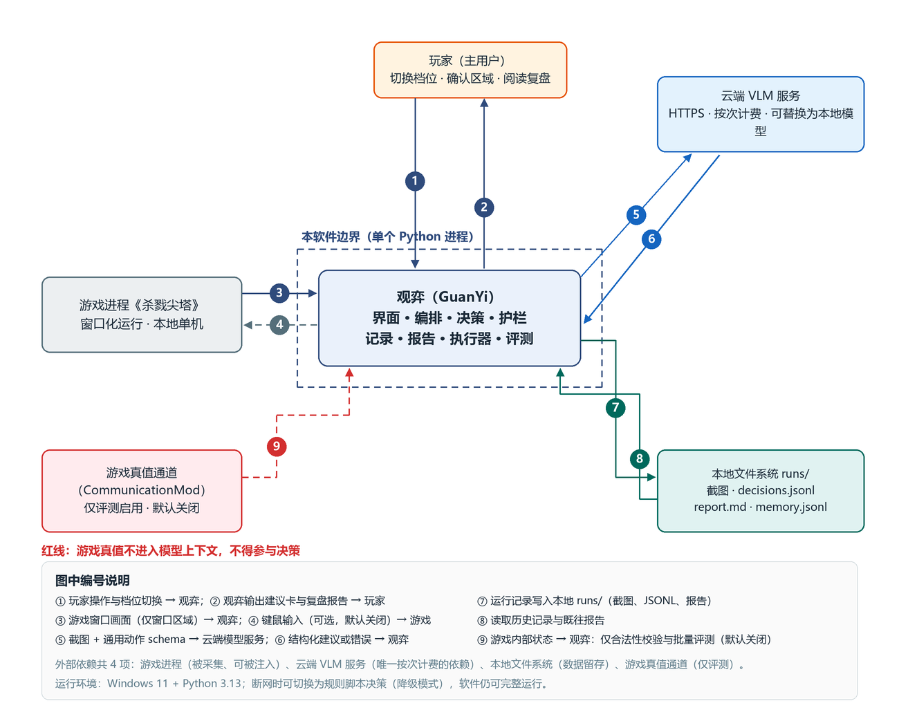

图 2　软件与外部环境关系图：虚线框内为本软件（单个 Python 进程），框外为 4 项外部依赖，箭头 ①—⑨ 的数据流见下表；红色虚线为游戏真值通道，**不进入模型上下文**。

| 外部对象              | 归属                 | 交互内容                                                         | 可否替换                 |
| --------------------- | -------------------- | ---------------------------------------------------------------- | ------------------------ |
| 玩家                  | 外部用户             | ① 操作与档位 → 软件；② 建议卡与复盘 → 玩家                   | —                       |
| 游戏进程              | 外部依赖（本地）     | ③ 窗口画面（仅窗口区域）→ 软件；④ 键鼠输入（默认关闭）→ 游戏 | 换截图区域即适配同类游戏 |
| 云端 VLM 服务         | 外部依赖（网络）     | ⑤ 截图＋动作 schema → 服务；⑥ 建议或错误 → 软件              | 可替换，见 3.2.3         |
| 本地文件系统`runs/` | 本软件产生的数据     | ⑦ 写入运行记录；⑧ 读取历史与报告                               | 可迁移目录               |
| 游戏真值通道          | 外部依赖（评测专用） | ⑨ 内部状态 → 软件，仅用于合法性校验与评测                      | 可关闭，不影响日常使用   |

> 属于本软件：截图区域选择、Prompt 与解析、护栏、记录、复盘报告、执行器编排、评测统计。不属于本软件：游戏本体、模型服务、系统截屏与输入通道。模型按**云端 API** 调用，不随软件分发。

#### 3.3.2 总体架构与模块职责

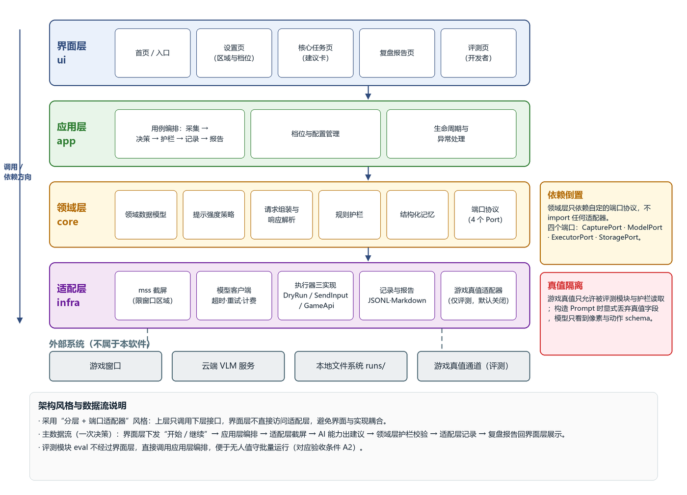

图 3　总体架构图：自上而下为界面层、应用层、领域层、适配层，箭头为调用／依赖方向；右侧注记分别为**依赖倒置**与**真值隔离**；最下一行为外部系统。

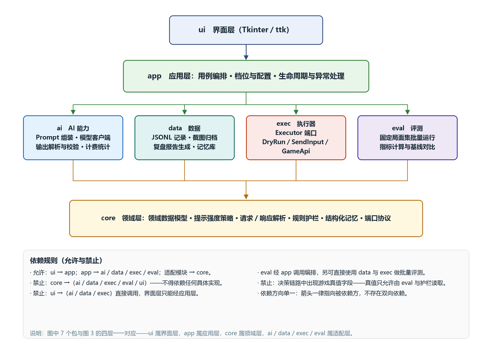

图 4　模块结构图：7 个包的依赖关系（箭头指向被依赖方），`core` 在最下层且**无出边**；右下为依赖规则。

| 模块（层）      | 职责                                                                   | 对外提供                       | 依赖                                           |
| --------------- | ---------------------------------------------------------------------- | ------------------------------ | ---------------------------------------------- |
| `ui` 界面层   | 页面与交互                                                             | 页面与事件回调                 | `app`                                        |
| `app` 应用层  | 用例编排、配置与档位、异常与生命周期                                   | 决策编排入口                   | `core`／`ai`／`data`／`exec`／`eval` |
| `core` 领域层 | 领域数据、档位策略、请求组装与解析、规则护栏、记忆、**端口协议** | `Guardrail`、端口 Protocol   | 无（不依赖任何实现）                           |
| `ai` 适配层   | Prompt 组装、模型调用、输出解析与校验、时延与费用统计                  | `ModelPort` 实现             | `core`                                       |
| `data` 适配层 | JSONL 记录、截图归档、复盘报告、记忆库                                 | `StoragePort` 实现、报告生成 | `core`                                       |
| `exec` 适配层 | DryRun／SendInput／GameApi（预留）                                     | `ExecutorPort` 三种实现      | `core`                                       |
| `eval` 适配层 | 固定局面集批量运行、指标与基线对比                                     | 评测指标                       | `app`／`data`／`exec`／`core`          |

**依赖规则（检查项）**：禁止 `core` 依赖任何实现；禁止 `ui` 直连 `ai`／`data`／`exec`；决策链路中禁止出现游戏真值字段；依赖方向单一，无双向依赖。

#### 3.3.3 用户—普通程序—模型—工具职责划分

| 环节       | 玩家                   | 普通程序（规则）               | 模型（LLM）                        | 工具／外部系统          | 谁检查 AI 结果               |
| ---------- | ---------------------- | ------------------------------ | ---------------------------------- | ----------------------- | ---------------------------- |
| 采集画面   | 确认截图区域           | 截取窗口区域、判定有效性       | —                                 | 系统截屏接口            | 程序（有效性规则）           |
| 局面理解   | —                     | 组装请求、附动作 schema        | **理解手牌、能量、敌人意图** | 云端 VLM                | 程序（字段完整性）           |
| 生成建议   | —                     | 校验输出结构                   | **给动作＋依据＋置信度**     | —                      | **程序＋玩家**         |
| 合法性校验 | —                     | **护栏（放行权在程序）** | —                                 | 游戏真值（仅评测）      | 程序（以规则为准）           |
| 执行动作   | 自己打或点“采用建议” | 选执行器、检出是否生效         | —                                 | 键鼠注入（默认 DryRun） | 程序（画面变化确认）         |
| 记录       | —                     | **四项记录**             | —                                 | 本地文件系统            | 程序（字段校验）             |
| 复盘       | 阅读并对照实际操作     | **统计与报告生成**       | 复盘叙述文字                       | —                      | **玩家（最终判断权）** |
| 评测       | —                     | 批量运行、指标计算与基线对比   | 被批量调用                         | 游戏真值（仅评测）      | 程序（指标口径固定）         |

### 3.4 数据、接口与核心流程设计（对应 2.4）

#### 3.4.1 核心数据模型

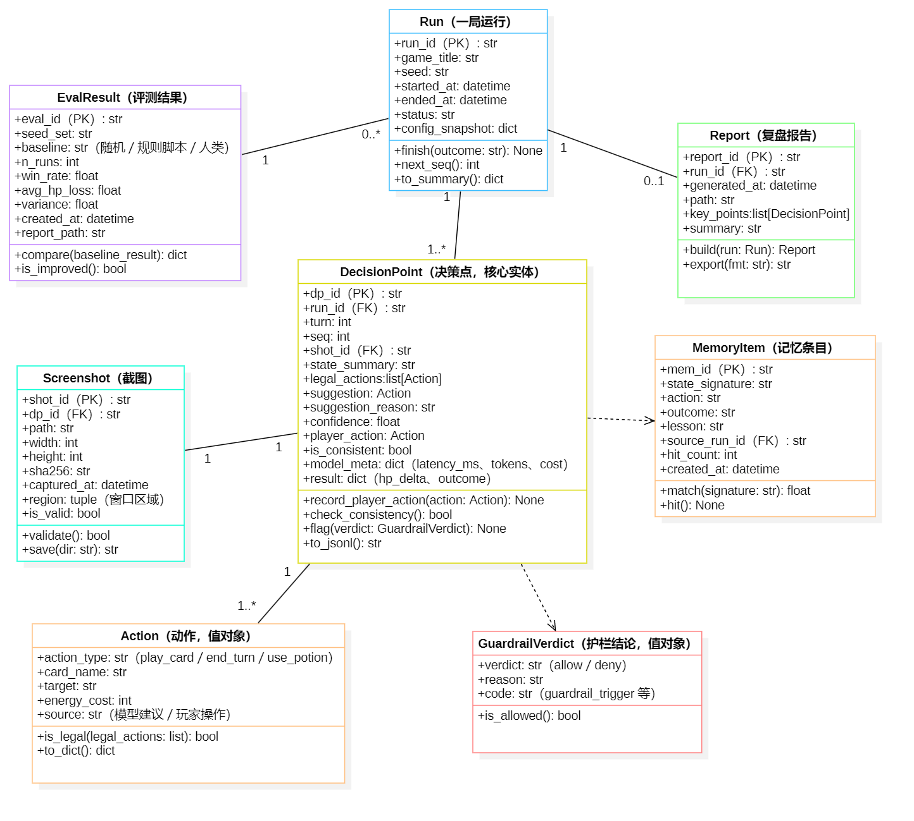

图 5　核心数据模型：8 个类，`DecisionPoint` 为核心实体；实线为关联（标重数），虚线为依赖（`GuardrailVerdict`、`MemoryItem`）。

| 数据对象                         | 关键字段                                                                                                                        | 约束                                                                                                | 保存与敏感                               |
| -------------------------------- | ------------------------------------------------------------------------------------------------------------------------------- | --------------------------------------------------------------------------------------------------- | ---------------------------------------- |
| `Run`                          | `run_id`(PK)、`seed`、`status`、`config_snapshot`                                                                       | `status` ∈ {running, finished, aborted}                                                          | `runs/<run_id>/run.json`               |
| `DecisionPoint`                | `dp_id`(PK)、`run_id`(FK)、`seq`、`legal_actions`、`suggestion`、`confidence`、`player_action`、`is_consistent` | `(run_id, seq)` 唯一；`confidence` ∈ [0,1]；建议须属于合法动作集，否则记 `guardrail_trigger` | `decisions.jsonl`                      |
| `Screenshot`                   | `shot_id`(PK)、`dp_id`(FK)、`sha256`、`region`、`is_valid`                                                            | 一决策点一张；`is_valid=false` 不得参与决策                                                       | **敏感**：只截窗口区域，不入版本库 |
| `Action`、`GuardrailVerdict` | 动作类型／目标／费用；verdict／reason／code                                                                                     | 值对象，内嵌于`DecisionPoint`                                                                     | 随决策点落盘                             |
| `MemoryItem`                   | `mem_id`(PK)、`state_signature`、`lesson`、`hit_count`                                                                  | `state_signature` 唯一                                                                            | `memory.jsonl`                         |
| `Report`                       | `report_id`(PK)、`run_id`(FK)、`key_points`                                                                               | 一局一份，可重复生成                                                                                | `runs/<run_id>/report.md`              |
| `EvalResult`                   | `eval_id`(PK)、`seed_set`、`baseline`、`win_rate`、`variance`                                                         | `n_runs` ≥ 1                                                                                     | `runs/eval/<eval_id>.json`             |

**敏感数据三条约定**：仅截游戏窗口区域（依据 Q12：50.0% 用户要求）；API 密钥只从环境变量读取，不进任何数据实体；`runs/` 加入 `.gitignore`。

#### 3.4.2 接口设计

| 编号 | 提供模块           | 调用者          | 用途           | 输入 → 输出                                               | 失败情况                                                   |
| ---- | ------------------ | --------------- | -------------- | ---------------------------------------------------------- | ---------------------------------------------------------- |
| I-1  | `exec`           | `app`         | 截取窗口区域   | 区域 → PNG＋尺寸＋`sha256`                              | 窗口不存在 →`CaptureError`；黑屏 → `is_valid=false`  |
| I-2  | `ai`             | `app`         | 由截图生成建议 | 截图＋动作 schema＋档位 →`{action, reason, confidence}` | 超时／5xx／空返回／非法 JSON（重试 1 次）                  |
| I-3  | `core`           | `app`         | 合法性校验     | 动作＋合法集 →`Verdict`                                 | 合法集为空 → 视为`deny`，不猜测                         |
| I-4  | `exec`           | `app`         | 应用动作       | 动作 →`ok`／未生效                                      | 注入失败 →`InjectionFailure`（重试 ≤2）；DryRun 不注入 |
| I-5  | `data`           | `app`         | 记录决策点     | `DecisionPoint` → —                                    | 磁盘满／无权限 →`StorageError`                          |
| I-6  | `data`           | `app`／`ui` | 生成复盘报告   | `run_id` → `report.md` 路径                           | 无记录 →`EmptyRunReport`                                |
| I-7  | `eval`           | `cli`／`ui` | 批量评测       | 局面集＋基线 → 胜率／损耗／方差                           | 单局失败 → 跳过并记`skipped`                            |
| I-8  | `core`／`data` | `app`         | 取相似历史局面 | 局面特征＋k → 记忆列表                                    | 无命中 → 空列表                                           |

**正常调用示例**

```jsonc
// app → ai：模型只看到像素与通用动作 schema，不含任何游戏真值
{ "request_id": "req-20260928-0007", "tier": "per_decision",
  "image": { "path": "runs/run-0007/screenshots/0007.png", "sha256": "9f2c…", "width": 1280, "height": 720 },
  "action_schema": { "types": ["play_card", "end_turn", "use_potion"], "fields": ["card_name", "target"] } }
// ai → app
{ "status": "ok",
  "action": { "action_type": "play_card", "card_name": "打击", "target": "颚虫", "energy_cost": 1 },
  "reason": "先用低费攻击压低敌方血量，保留能量给防御牌", "confidence": 0.78,
  "meta": { "model": "deepseek-flash", "latency_ms": 2140, "tokens_in": 1180, "tokens_out": 96, "cost": 0.0021 } }
// core → app：护栏结论
{ "verdict": "allow", "reason": "动作在手牌与能量允许范围内", "code": "ok" }
```

**错误调用示例**

```jsonc
// ① 模型空返回（重试 1 次后）→ 不猜测，转人工确认（A3）
{ "status": "error", "error": { "code": "empty_response", "message": "模型未返回内容" }, "meta": { "retry": 1 } }
// 写入 decisions.jsonl 的记录
{ "dp_id": "dp-0007-03", "confidence": 0.0,
  "guardrail": { "verdict": "deny", "code": "low_confidence", "reason": "画面不可辨，未给出建议" },
  "ui_action": "pause_and_ask_human" }
// ② 动作未生效（连续 2 次）→ 停止自动执行并提示（A4）
{ "status": "error",
  "error": { "code": "injection_failure", "message": "动作未生效：前后截图哈希未变化", "attempts": 2 },
  "ui_action": "stop_auto_and_notify" }
```

#### 3.4.3 核心流程与失败处理

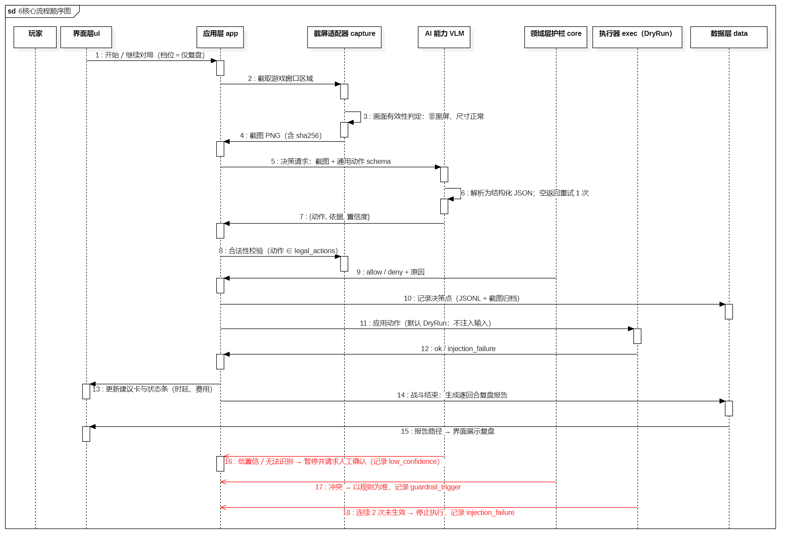

图 6　核心流程顺序图：消息 1—15 为一次决策的正常路径（采集 1—4／决策与校验 5—9／记录与反馈 10—15），16—18（红色）为三条异常分支，均指向应用层。

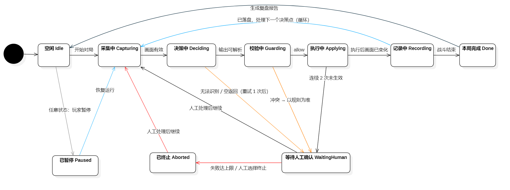

图 7　失败恢复状态图：主链为 空闲 → 采集中 → 决策中 → 校验中 → 执行中 → 记录中 → 本局完成；橙色为异常转人工确认，灰为玩家暂停，红为终止与恢复，蓝为循环与恢复。

| 失败类型         | 检出方式                 | 重试上限                                | 达上限后的状态与界面                                             | 记录字段                              |
| ---------------- | ------------------------ | --------------------------------------- | ---------------------------------------------------------------- | ------------------------------------- |
| 模型超时／空返回 | 超时或响应体为空         | **1 次**                          | 等待人工确认；模态给出**重拍截图／跳过该决策点／结束本局** | `model_timeout`／`low_confidence` |
| 输出非法 JSON    | 解析失败                 | **1 次**（附“只输出 JSON”提醒） | 同上                                                             | `parse_error`                       |
| 画面不可辨       | 模型弃权或截图有效性失败 | **不重试**（改重拍 1 次）         | 同上                                                             | `low_confidence`                    |
| 动作未生效       | 注入前后截图哈希未变化   | **2 次**                          | 停止自动执行；状态条变红并提示（A4）                             | `injection_failure`                 |
| 护栏冲突         | `verdict = deny`       | **0 次**，以规则为准              | 继续本局，建议卡标红并请求确认（A5）                             | `guardrail_trigger`                 |
| 记录写入失败     | IO 异常                  | 2 次                                    | 已暂停并提示检查磁盘                                             | `storage_error`                     |

> **任何情况下都不出现无限重试**；无人值守的评测模式下，“等待人工确认”自动转为“跳过该局并记录”，不阻塞批次（A2）。

### 3.5 界面原型与交互设计（对应 2.5）

#### 3.5.1 页面结构与导航

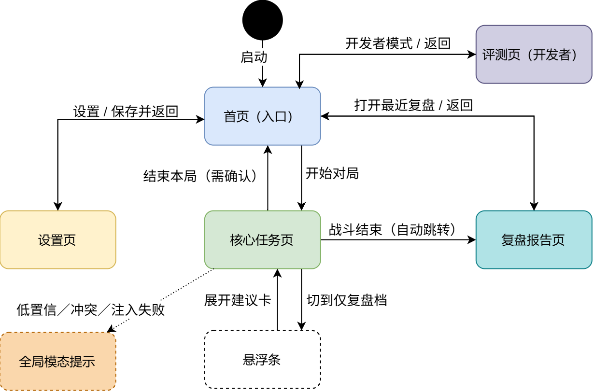

图 8　页面结构与导航关系图：启动后进入首页，由此进入设置页、核心任务页、复盘报告页与评测页；双向箭头为“进入／返回”合并，虚线为悬浮条与全局模态提示。

| 页面／节点         | 职责                                       | 进入与可用命令                                       | 离开方式                               |
| ------------------ | ------------------------------------------ | ---------------------------------------------------- | -------------------------------------- |
| 首页               | 入口与状态总览（窗口、档位、模型连通）     | 开始对局／仅复盘模式／打开最近复盘／设置／开发者模式 | 进入上述页面或退出                     |
| 设置页             | 截图区域、提示强度、模型与密钥、数据与隐私 | 框选区域／切档位／填接口地址／清理运行目录           | 保存并返回                             |
| 核心任务页         | 局面区、建议卡、操作区、状态栏             | 采用建议／我自己打／跳过此决策点／暂停／结束本局     | 战斗结束自动跳复盘页；或结束本局回首页 |
| 悬浮条（仅复盘档） | 不打断游玩的最低干扰提示                   | 展开建议卡／暂停记录                                 | 展开回核心任务页                       |
| 复盘报告页         | 结果摘要、逐回合表、关键决策点             | 导出 Markdown／PDF／再来一局                         | 返回首页                               |
| 评测页（开发者）   | 局面集、基线、指标                         | 选择局面集与基线／运行评测                           | 返回首页                               |
| 全局模态提示       | 低置信、冲突、注入失败三类中断             | 重拍截图／跳过该决策点／结束本局                     | 处理后回触发页面                       |

#### 3.5.2 关键界面原型

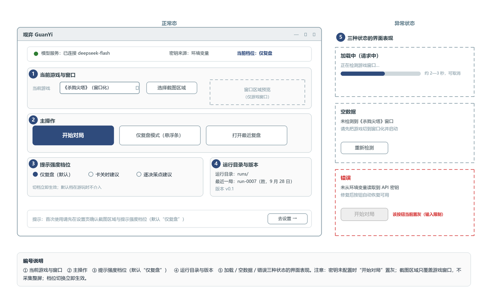

图 9　首页：① 当前游戏与窗口 ② 主操作 ③ 提示强度档位（**默认“仅复盘”**）④ 运行目录与版本 ⑤ 加载／空数据／错误三种状态；密钥未配置时“开始对局”置灰。

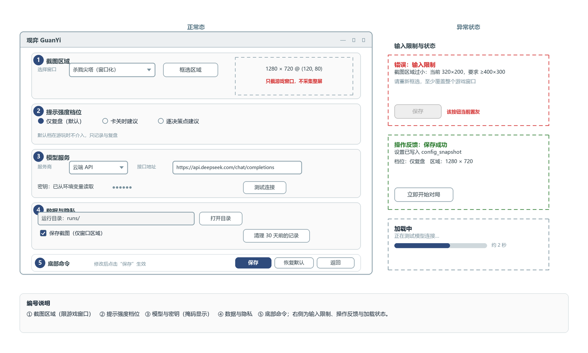

图 10　设置页：① 截图区域（**只截游戏窗口、不采集整屏**）② 提示强度三档 ③ 模型与密钥（掩码显示）④ 数据与隐私 ⑤ 底部命令；右侧为输入限制（区域过小则保存置灰）与操作反馈。

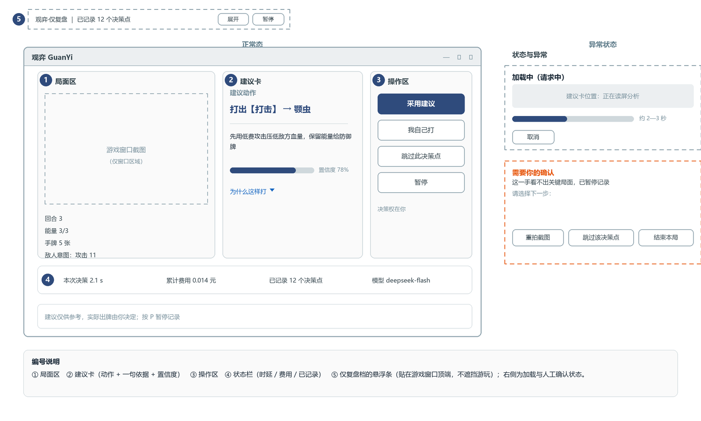

图 11　核心任务页：① 局面区 ② 建议卡（动作＋一句依据＋置信度）③ 操作区 ④ 状态栏（时延／费用／已记录）⑤ 仅复盘档悬浮条；右侧为加载中与人工确认（三选一出口）。

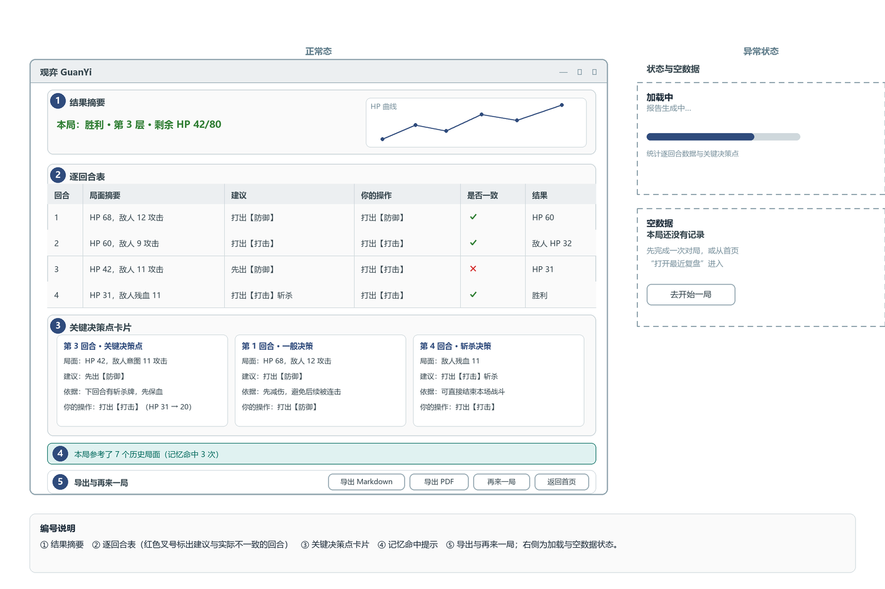

图 12　复盘报告页：① 结果摘要 ② 逐回合表（红色叉号标出**建议与实际不一致**的回合）③ 关键决策点卡片 ④ 记忆命中提示 ⑤ 导出与再来一局；右侧为加载与空数据状态。

#### 3.5.3 界面状态与交互约定

| 状态       | 出现位置                           | 界面表现                                                 | 对应验收 |
| ---------- | ---------------------------------- | -------------------------------------------------------- | -------- |
| 加载中     | 决策请求、报告生成、批量评测       | 进度提示＋预估时间＋可取消                               | 性能需求 |
| 空数据     | 未检测到游戏窗口、本局无记录       | 说明原因＋“重新检测／去开始一局”                       | A1       |
| 错误       | 模型异常、动作未生效、截图区域过小 | 中文原因＋可采取的下一步；相关按钮置灰                   | A3／A4   |
| 需人工确认 | 低置信、护栏冲突、切入自动执行前   | 模态提示，三个明确出口：重拍截图／跳过该决策点／结束本局 | A3／A5   |

**交互约定**：档位切换立即生效并写入 `config_snapshot`；每个决策点都提供“我自己打”出口，**决策权始终在玩家**；三类中断一律使用模态＋中文动作选项，不靠颜色区分。

### 3.6 设计一致性检查与版本保存（对应 2.6）

**检查范围与方法**：功能需求 10 条（含 FR-09 三层拆分）、非功能需求 5 类、验收条件 5 条、设计图 12 张、接口 8 个、页面 7 个。按 3.1.2 的对应表逐行走查“需求 → 模块 → 数据／接口 → 界面 → 验收”，确认无悬空需求与无主设计；另对 4 条硬约束做专项核对：真值隔离、重试上限、仅窗口区域截图、执行器可插拔。对应表已在 3.1.2 完善，按要求不另制重复表。

| 编号 | 发现的问题                                                | 设计调整                                                                               |
| ---- | --------------------------------------------------------- | -------------------------------------------------------------------------------------- |
| Q1   | FR-09B 自动化接口在界面上无入口，开发者无法触达           | 首页增加“开发者模式”入口进评测页；接口由`cli` 提供（图 8）                         |
| Q2   | FR-08 记忆机制在界面上不可见，用户无法感知                | 复盘报告页增加“本局参考了 N 个历史局面”（图 12）                                     |
| Q3   | 默认档若为“逐决策点建议”，与 C5“教练而非替身”定位冲突 | 默认档固定“仅复盘”；首次启动经设置页确认档位与区域                                   |
| Q4   | 性能目标 P95 ≤ 5 s 与实测 8321 ms 冲突                   | 界面增加“请求中”与预估提示；目标保留并标注**未达标**（ADR-05），不静默改指标   |
| Q5   | A5 要求“提示玩家确认”，但初版原型无确认入口             | 核心任务页增加“跳过此决策点”＋全局模态提示（图 8、图 11）                            |
| Q6   | 执行器可插拔是硬约束，但初版应用层直接创建了具体执行器    | 应用层只依赖`ExecutorPort`，实现由配置装配（图 3、图 4 的依赖倒置与“core 无出边”） |

**结论**：6 处问题均已调整，每条需求都能落到模块、数据／接口、界面与验收条件之一；唯一未解决项是性能目标未达标，已如实记录（ADR-05），留待实验4 复核，不属设计遗漏。

**仓库版本证据**（`https://github.com/wmbrhbhdzr/guanyi-agent`，提交信息 `docs: 完成实验3 软件架构与界面设计（12 张设计图 + 架构／数据／接口／界面设计）`）

| 文件路径                            | 说明                                               |
| ----------------------------------- | -------------------------------------------------- |
| `docs/实验3-设计图.drawio`        | 图 8 的绘制工程                                    |
| `docs/观弈设计模型.mdj`           | 图 5—图 7 的 StarUML 工程（类图／顺序图／状态图） |
| `docs/实验3-画图清单.md`          | 12 张图的绘制规格与配色／编号约定                  |
| `scripts/draw_exp3_figs.py`       | 图 1—图 4、图 9—图 12 的生成脚本（可复现）       |
| `scripts/flatten_white.py`        | 导出 PNG 的透明底处理脚本                          |
| `image/实验3-软件架构与界面设计/` | 图 1—图 12 的 PNG                                 |

## 4. 实验小结

**成果**：把实验2 的需求落成可开发的设计基线——一张兼作需求清单与双向追踪的对应表（3.1.2）、5 条 ADR、4 项关键依赖的替代方案、8 个包的分层＋端口适配器架构、8 类数据模型与 8 个接口（含正常与两类错误调用示例）、12 张设计图。

**关键决策**：`core` 在依赖图中无出边，据此同时满足“真值隔离”与“执行器可插拔”；数据用 JSONL＋每局一目录换取可读与可回放；模型走云端 API 并配三级替代（本地模型 → 规则脚本降级），**降级后仍是完整软件，且规则脚本本身就是评测基线**。

**检查与不足**：共修正 6 处需求与设计对不齐的问题（Q1—Q6）；性能目标 P95 ≤ 5 s 未达标，未用改设计掩盖，而是保留目标并写入 ADR-05。下一步按 3.3 的模块划分与 3.4 的接口定义，优先实现 I-1、I-2、I-3、I-5 四个接口，跑通“一次决策”最小闭环。
