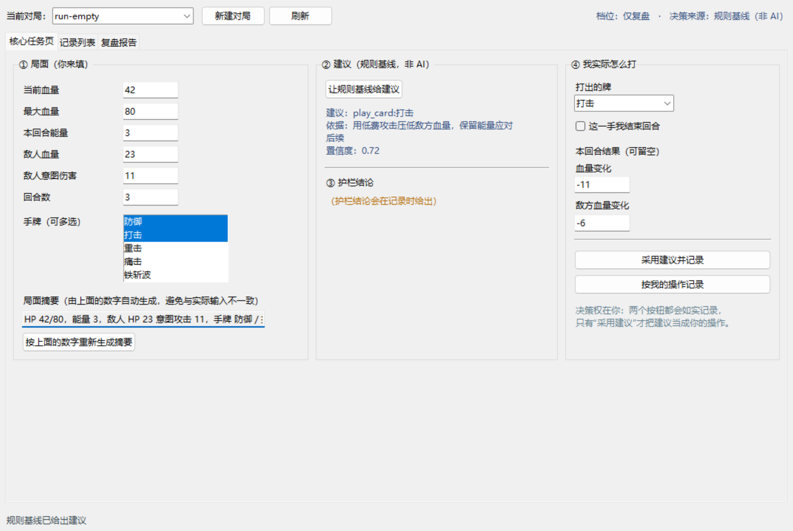
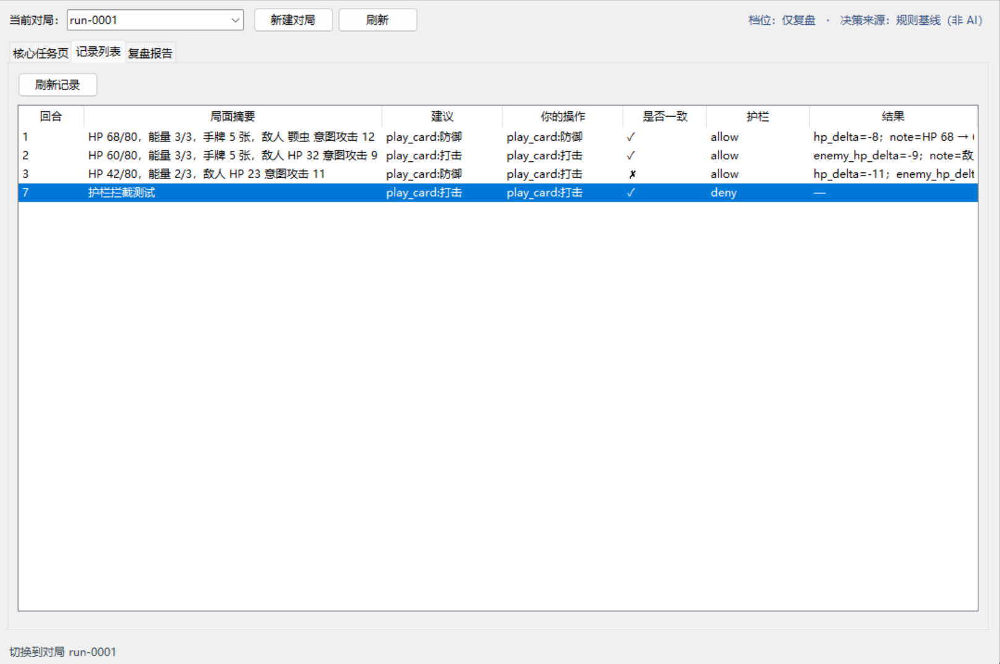
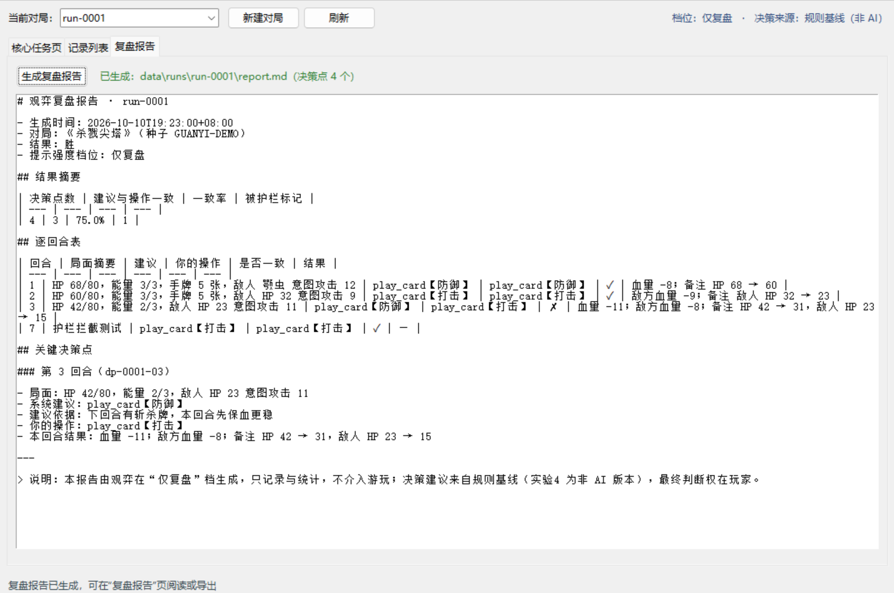
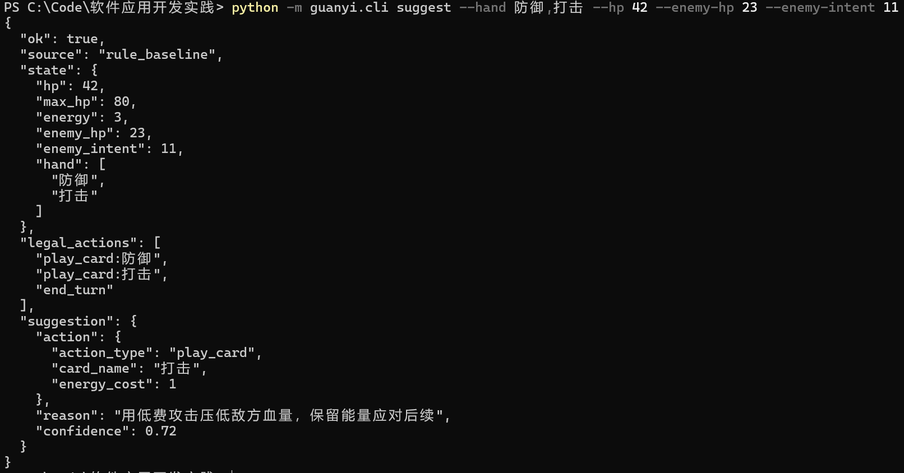
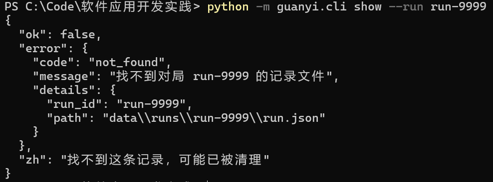
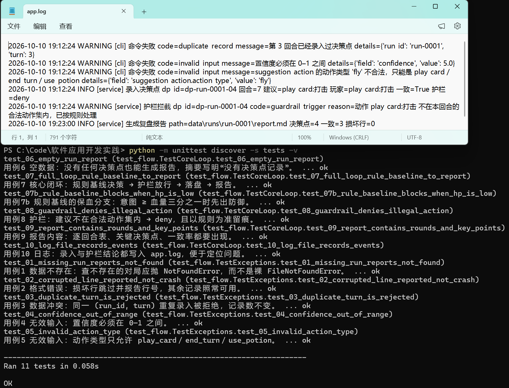
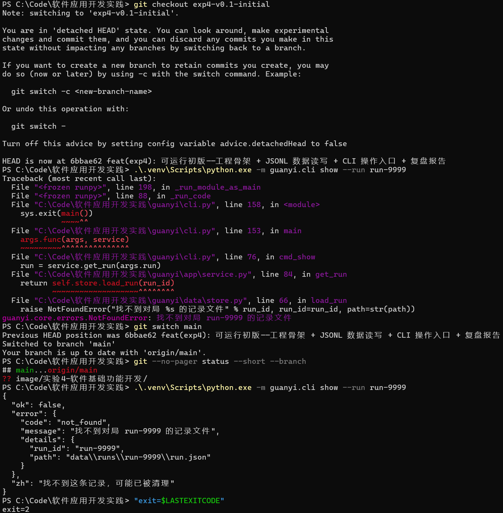

# 实验4：软件基础功能开发

## 学习通提交说明

- **提交平台：** 只向学习通对应的作业上传一份PDF文件。
- **文件命名：** 班级-学号-姓名-实验4-软件基础功能开发.pdf。
- **PDF内容：** 可运行基础功能版本说明、核心业务闭环、测试与复测记录、AI辅助编码审查，以及初版与修订版的仓库版本证据。
- **截止时间：** 以学习通作业设置为准；报告中的仓库链接与Commit用于过程核验。

## 1. 实验目的

- 依据需求与设计基线实现个人软件的非AI业务闭环，形成可持续迭代的工程骨架。
- 以Spring Boot + Vue前后端开发为课堂讲解和示范案例，理解界面、接口、业务逻辑与数据保存之间的协作方式，并能将这些方法应用到本人选择的技术栈中。
- 学会审查AI辅助生成的代码，并以版本记录、测试和解释证明本人完成。

## 2. 实验内容

### 2.1 迭代计划

- 将实验四拆分为“可运行初版”和“测试修订版”两个版本迭代，列出任务、完成条件和风险。
- “可运行初版”完成项目骨架，使程序能够正常启动，并至少完成一次核心数据的读取或保存以及一个页面、接口或操作入口。
- “测试修订版”补全一条基础业务流程，根据检查和测试结果修复问题。
- 为初版和修订版分别保留可运行、可演示的Commit或Tag，并说明两个版本之间的具体变化。

### 2.2 项目骨架与核心数据

- 以课堂示例项目为例，后端可以按照控制层、业务层和数据访问层组织代码，前端可以按照页面、组件、路由和接口调用组织代码；不限制技术栈，但需说明各目录或模块承担的职责。
- 实现核心数据结构及数据保存或状态管理，说明数据库、文件或内存数据的初始化方式。数据库类型和数据访问技术可根据项目需要自行选择并给出选择理由。
- 提供一组可重复使用的样例数据，并说明如何初始化、清空或恢复；同时处理数据为空、重复、格式错误或读取失败等与本项目有关的情况。

### 2.3 主要页面、接口与数据交互

- 在课堂示例项目中，使用后端接口接收请求、调用业务逻辑并返回结果，由Vue页面发起请求和显示数据；采用其他技术栈时，应实现等价的界面或操作入口与业务逻辑之间的数据交互。
- 根据个人软件的核心流程，实现必要的输入、列表或详情、编辑或业务操作页面。
- 说明主要接口或模块调用的输入、输出和校验规则，并分别展示正常数据、空数据和错误输入时的页面、接口或程序反馈。

### 2.4 非AI关键业务闭环

- 选择一条核心用户故事，从用户输入、业务处理、数据保存到结果反馈完整实现。
- 对照实验3的设计结果，说明各步骤对应的页面、接口、业务模块、数据处理和验收条件。
- 模拟真实用户，使用具有真实业务含义的测试输入完整运行该流程，保存关键步骤和最终结果，不能用静态页面代替实际执行。

### 2.5 异常处理、日志与基础测试

- 选择与个人软件实际有关的无效输入、数据不存在、依赖不可用或数据冲突等异常进行处理，避免程序直接崩溃或没有反馈。
- 结合实验2和实验3的设计，整理并执行不少于6个测试用例，记录预期结果、初版结果、修复内容和修订版复测结果。
- 记录能够帮助定位问题的必要日志，说明日志位置和主要内容。

### 2.6 AI辅助编码审查

- 选取一次AI生成或修改代码的任务，使用AI协作记录说明任务、关键输入、AI建议、采用或拒绝的内容、人工修改和测试验证。
- 不得只粘贴AI回答；必须解释关键代码为何正确、有哪些局限。
- 使用代码审查检查不存在的接口、无用依赖、遗漏的异常处理或明显安全问题，并记录至少一处“AI初稿—人工修正—测试通过”的完整证据。

## 3. 操作记录

> 本次实验实现的是**非AI 业务闭环**：用 `rule_baseline` 规则基线顶替视觉语言模型，
> 这样闭环不依赖任何模型服务也能完整演示与测试。
>
> 两个版本都用 Tag 固定，可随时检出复现：
>
> | 版本       | Tag                   | Commit      | 一句话                                                           |
> | ---------- | --------------------- | ----------- | ---------------------------------------------------------------- |
> | 可运行初版 | `exp4-v0.1-initial` | `a3ab20d` | 骨架 + 数据读写 + CLI 入口 + 复盘报告（无校验、无去重、无日志）  |
> | 测试修订版 | `exp4-v0.2-tested`  | `60afacc` | 补全闭环（护栏／规则基线／界面三页）+ 异常与日志 + 11 个测试用例 |
>
> 仓库：`https://github.com/wmbrhbhdzr/guanyi-agent`

### 3.1 迭代计划（对应 2.1）

**两个迭代的任务、完成条件与风险**

| 版本       | 任务                                                                                                           | 完成条件                                                                                  | 主要风险                                                                 |
| ---------- | -------------------------------------------------------------------------------------------------------------- | ----------------------------------------------------------------------------------------- | ------------------------------------------------------------------------ |
| 可运行初版 | 按实验3 的分层设计建`guanyi` 包；实现领域对象与 JSONL 读写；CLI 入口；样例数据；基础复盘报告                 | 程序能启动（`python -m guanyi.cli --help`）；能写入并读回一局数据；能生成 `report.md` | 只求“跑通”，会把校验、去重、异常与日志留到下一版 → 已知缺陷（见 3.5） |
| 测试修订版 | 补全一条完整业务流程（录入 → 护栏 → 决策 → 记录 → 报告）；Tkinter 三页界面；统一异常与日志；按测试结果修复 | 6 个用例从“失败/未覆盖”变为“通过”；界面三页可操作；`app.log` 有定位信息             | 改动面较大，可能引入回归 → 用 11 个自动化用例兜住                       |

**两版之间的具体变化**

| 维度       | v0.1 可运行初版                                                | v0.2 测试修订版                                                                                                                        |
| ---------- | -------------------------------------------------------------- | -------------------------------------------------------------------------------------------------------------------------------------- |
| 新增模块   | `core/{models,errors}`、`data/*`、`app/service`、`cli` | `core/{actions,guardrail,rule_baseline}`、`app/logging_setup`、`ui/main_window`、`tests/test_flow.py`、`scripts/ui_smoke.py` |
| 业务能力   | 只能手工录入建议动作                                           | 规则基线自动出建议 + 规则护栏校验 + 冲突留痕                                                                                           |
| 界面       | 只有命令行                                                     | 三个页签：核心任务页 / 记录列表 / 复盘报告                                                                                             |
| 数据健壮性 | 无校验、无去重、损坏行直接崩                                   | 字段校验、`(run_id, turn)` 去重、损坏行跳过并报行号                                                                                  |
| 异常与日志 | 异常栈直接抛给用户                                             | 统一`GuanyiError` + 中文提示 + 退出码；`app.log` 记录关键事件                                                                      |
| 测试       | 无                                                             | 11 个用例，全部通过                                                                                                                    |
| 代码规模   | 约 740 行                                                      | 约 2000 行（含注释）                                                                                                                   |

### 3.2 项目骨架与核心数据（对应 2.2）

#### 3.2.1 目录结构与分层职责

本项目是 **Python + Tkinter 桌面前端 + JSONL 文件存储**，与课堂示例（Spring Boot + Vue）的对应关系如下：

| 课堂示例的分层       | 本项目的模块                                       | 职责                                                            |
| -------------------- | -------------------------------------------------- | --------------------------------------------------------------- |
| 控制层（Controller） | `guanyi/cli.py`、`guanyi/ui/main_window.py`    | 接收用户输入、调用业务、返回结果；**不直接读写文件**      |
| 业务层（Service）    | `guanyi/app/service.py`                          | 用例编排：开始对局 → 录入决策点 → 护栏 → 记录 → 生成报告    |
| 领域层（Domain）     | `guanyi/core/`                                   | 领域对象与规则：数据模型、动作校验、规则基线、统一错误码        |
| 数据访问层（DAO）    | `guanyi/data/`                                   | JSONL 读写、样例数据、复盘报告渲染                              |
| 外部能力适配         | `guanyi/ai/`、`guanyi/exec/`、`guanyi/eval/` | AI 决策（实验5）、动作执行器、批量评测（实验6），实验4 仅留占位 |

```
guanyi/
├── cli.py              命令行入口（9 个子命令，see 3.3）
├── ui/main_window.py   Tkinter 三页：核心任务页 / 记录列表 / 复盘报告
├── app/
│   ├── service.py      用例编排（SessionService）
│   └── logging_setup.py 按对局隔离的日志
├── core/
│   ├── models.py       Run / DecisionPoint / Report + 字段校验
│   ├── errors.py       统一错误码与中文提示
│   ├── actions.py      动作类型白名单与归一化
│   ├── guardrail.py    规则护栏（接口 I-3）
│   └── rule_baseline.py 规则基线决策器（非 AI）
├── data/
│   ├── store.py        JSONL 存储（StoragePort 实现）
│   ├── reporter.py     逐回合复盘报告生成
│   └── sample.py       样例数据：seed / clear / restore
├── ai/ exec/ eval/     实验5、6 的适配层占位
scripts/{demo_data.py, ui_smoke.py, draw_exp3_figs.py, flatten_white.py}
tests/test_flow.py      11 个测试用例（标准库 unittest）
```

#### 3.2.2 核心数据结构与数据保存

| 数据结构          | 关键字段                                                                                                                                                               | 约束                                                                                                                    |
| ----------------- | ---------------------------------------------------------------------------------------------------------------------------------------------------------------------- | ----------------------------------------------------------------------------------------------------------------------- |
| `Run`           | `run_id`、`seed`、`status`、`config_snapshot`、`outcome`                                                                                                     | `status` ∈ {running, finished, aborted}；`outcome` ∈ {胜, 负, 中止}                                               |
| `DecisionPoint` | `dp_id`、`run_id`、`turn`、`seq`、`state_summary`、`legal_actions`、`suggestion_action`、`player_action`、`is_consistent`、`guardrail`、`result` | 回合数与序号 ≥ 1；`confidence` ∈ [0,1]；动作类型必须是 `play_card／end_turn／use_potion`；`(run_id, turn)` 唯一 |
| `Report`        | `report_id`、`run_id`、`generated_at`、`path`                                                                                                                  | 一局一份，可重复生成（覆盖）                                                                                            |

**保存方式**：一局一个目录 + JSONL，物理位置 `data/runs/`。

```
data/runs/index.json                 对局索引（列表页使用）
data/runs/<run_id>/run.json          一局元信息
data/runs/<run_id>/decisions.jsonl   逐决策点记录（每行一条 JSON）
data/runs/<run_id>/report.md         复盘报告
data/runs/<run_id>/app.log           运行日志
```

**为什么用文件而不用数据库**（沿用实验3 ADR-03）：人可直接读、可 diff、可回放；单机单人、数据量小，
不引入数据库依赖；代价是没有事务与并发控制，统计靠脚本——这些在实验6 的评测阶段可再评估是否迁到 SQLite。

#### 3.2.3 样例数据与初始化

样例数据是一局**有真实业务含义**的对局：3 个回合，第 3 回合“建议防御、玩家打出攻击”，因此报告里会出现一个关键决策点。

| 命令                                                     | 作用                                       |
| -------------------------------------------------------- | ------------------------------------------ |
| `python scripts/demo_data.py seed [--run-id run-0002]` | 写入一局样例数据（3 个决策点）             |
| `python scripts/demo_data.py clear`                    | 清空`data/runs/` 下所有对局              |
| `python scripts/demo_data.py restore`                  | 先清空、再重新写入样例对局（恢复出厂状态） |
| `python scripts/demo_data.py report --run-id run-0001` | 顺手生成该局复盘报告                       |

#### 3.2.4 数据异常的四类处置

| 异常     | 处置（v0.2）                                                                               | 对应位置                      |
| -------- | ------------------------------------------------------------------------------------------ | ----------------------------- |
| 数据为空 | 允许“没有任何决策点”的对局存在，报告明确写“本局没有决策点记录”                         | `reporter.build_report()`   |
| 数据重复 | 同一`(run_id, turn)` 重复录入 → `DuplicateError`，记录数不变                          | `service.record_decision()` |
| 格式错误 | 逐行解析，损坏行跳过并在`problems` 里给出行号；严格模式抛 `StorageError`               | `store.scan_decisions()`    |
| 读取失败 | 目录/文件不存在 →`NotFoundError`；`run.json`／`index.json` 损坏 → `StorageError` | `store.load_run()`          |

> **仓库问题与修复过程**：`.gitignore` 里原有的 `data/` 规则没有锚定仓库根目录，把**源码目录**
> `guanyi/data/`（数据访问层）一起忽略了，导致 v0.1／v0.2 两个提交都无法从干净克隆运行。
> 已改为根锚定写法 `/data/`、`/runs/`，并补提交该目录（commit `60afacc`）。这件事说明：
> 忽略规则必须能经受“误伤源码”的检查，仅凭“本地能跑”发现不了——因为被忽略的文件一直在磁盘上。

### 3.3 主要页面、接口与数据交互（对应 2.3）

#### 3.3.1 三个页面

| 页面       | 类型        | 内容                                                                                      | 对应实验3 原型             |
| ---------- | ----------- | ----------------------------------------------------------------------------------------- | -------------------------- |
| 核心任务页 | 输入页      | 局面数字、手牌多选、规则基线建议、护栏结论、玩家操作录入                                  | 图 11 核心任务页           |
| 记录列表   | 列表/详情页 | 对局下拉 + 决策点表格（回合｜局面｜建议｜实际｜是否一致｜护栏｜结果），空数据与损坏行提示 | 图 12 复盘报告页的上半部分 |
| 复盘报告页 | 结果页      | 一键生成并展示逐回合复盘报告全文                                                          | 图 12 复盘报告页           |



图 1　核心任务页（输入页）：① 局面由玩家填写；② 点“让规则基线给建议”后显示建议动作、依据与置信度；③ 记录时给出护栏结论；④ 玩家自己选择实际打法；“采用建议并记录”与“按我的操作记录”都会如实落盘（本轮建议 `play_card:打击`，置信度 0.72）。



图 2　记录列表页：`run-0001` 的 3 个样例决策点（第 3 回合建议与实际**不一致**，标 ✗）以及一次被护栏拦截的记录（第 7 回合，护栏列为 `deny`）。列表为空时会显示“本局还没有决策点（空数据）”，损坏行会在表格上方提示行号。



图 3　复盘报告页（结果页）：点“生成复盘报告”后展示报告全文（结果摘要、逐回合表、关键决策点），并在标题栏显示报告文件路径；报告同时落盘到 `data/runs/<run_id>/report.md`。

#### 3.3.2 主要接口（命令行入口 = 本项目的“接口层”）

界面与命令行**调用同一套应用层服务**，因此接口行为可以用命令行直接观察与留证：

| 接口        | 用途           | 输入                                                                                                           | 输出                              | 校验规则                                                       |
| ----------- | -------------- | -------------------------------------------------------------------------------------------------------------- | --------------------------------- | -------------------------------------------------------------- |
| `seed`    | 写入样例对局   | `--run-id`、`--outcome`                                                                                    | 对局信息 + 决策点数               | 对局不得重复（`seed` 为覆盖式初始化）                        |
| `start`   | 新建空对局     | `--run-id`、`--seed`                                                                                       | 对局信息 + 日志路径               | `run_id` 为空时自动生成                                      |
| `record`  | 录入决策点     | `--run --turn --state --play`（可选 `--suggest`／`--hand/--hp/--enemy-hp/--enemy-intent`／`--result`） | 决策点 + 一致性 + 护栏结论        | 回合 ≥1；动作类型白名单；`(run_id, turn)` 唯一；置信度 0–1 |
| `suggest` | 只调规则基线   | `--hand --hp --max-hp --energy --enemy-hp --enemy-intent`                                                    | 建议动作 + 依据 + 置信度          | 手牌可空（则建议结束回合）                                     |
| `show`    | 查看一局决策点 | `--run`                                                                                                      | 对局 + 决策点 +`problems`       | 对局不存在 →`not_found`                                     |
| `list`    | 列出所有对局   | —                                                                                                             | `count` + 对局数组              | —                                                             |
| `finish`  | 结束一局       | `--run --outcome`                                                                                            | 对局信息                          | `outcome` ∈ {胜, 负, 中止}                                  |
| `report`  | 生成复盘报告   | `--run`                                                                                                      | 报告路径 + 统计摘要 +`problems` | 无决策点也可生成                                               |
| `clear`   | 清空全部记录   | —                                                                                                             | 删除的对局数                      | —                                                             |

#### 3.3.3 正常 / 空数据 / 错误输入三种反馈

| 情况     | 观察入口                        | 实际反馈                                                                               |
| -------- | ------------------------------- | -------------------------------------------------------------------------------------- |
| 正常数据 | `suggest`（图 4）             | 返回建议动作、依据与置信度，`ok: true`                                               |
| 空数据   | `start` 后直接 `report`     | `ok: true`，`decision_count: 0`，报告正文写明“本局没有决策点记录”                |
| 错误输入 | `show --run run-9999`（图 5） | `ok: false`，`code: not_found`，中文提示“找不到这条记录，可能已被清理”，退出码 2 |



图 4　正常数据：`python -m guanyi.cli suggest --hand 防御,打击 --hp 42 --enemy-hp 23 --enemy-intent 11` 的输出——规则基线按“意图是否达到血量三分之一”等规则给出动作、依据与置信度（非 AI 决策）。



图 5　错误输入：查询不存在的对局时返回结构化错误与中文提示（`not_found` + “找不到这条记录，可能已被清理”），不是 Python 异常栈。

### 3.4 非AI关键业务闭环（对应 2.4）

**选定的核心用户故事：US-02**——“战斗结束后拿到逐回合复盘表，以便定位自己真正打错的那一回合”。
围绕它实现的完整闭环：

```
① 用户输入：在核心任务页填写局面（血量 / 能量 / 手牌 / 敌人意图）与自己的实际操作
② 业务处理：规则基线给出建议 → 规则护栏校验（不在合法动作集内则 deny，以规则为准）
③ 数据保存：决策点写入 decisions.jsonl；对局元信息写入 run.json 并更新 index.json
④ 结果反馈：记录列表立即显示该回合（含是否一致）；生成 report.md 并在报告页展示
```

**与实验3 设计的对照**

| 步骤         | 对应页面（实验3 图 8） | 接口／模块                                                 | 数据处理                                   | 验收条件             |
| ------------ | ---------------------- | ---------------------------------------------------------- | ------------------------------------------ | -------------------- |
| 局面录入     | 核心任务页             | `ui/main_window` → `SessionService.record_decision()` | 生成`state_summary` 与 `legal_actions` | A1（可解析、合法）   |
| 规则基线建议 | 核心任务页建议卡       | `core/rule_baseline.decide()`                            | 产`{action, reason, confidence}`         | A1                   |
| 护栏校验     | 护栏结论区             | `core/guardrail.check_action()`                          | 产`Verdict`，deny 时留痕                 | A5（冲突以规则为准） |
| 落盘         | 状态栏“已记录 N 个”  | `data/store.append_decision()`                           | 校验后写 JSONL                             | A1（记录四项）       |
| 报告反馈     | 复盘报告页             | `data/reporter.build_report()`                           | 统计一致率、标出关键决策点                 | A1／US-02            |

**真实业务输入的实际运行**（`run-0001`，非静态页面）：第 1 回合 HP 68、敌人意图 12、手牌 5 张 → 建议防御、玩家也防御（一致 ✓）；第 2 回合 HP 60、敌人 HP 32 → 建议打击、玩家打击（一致 ✓）；第 3 回合 HP 42、敌人 HP 23、意图 11 → 建议**防御**、玩家打出**打击**（不一致 ✗）。报告摘要：决策点 3 个、一致 2 个、一致率 66.7%，并在“关键决策点”里展开第 3 回合。以上全部对应图 1—图 3 的真实截图。

### 3.5 异常处理、日志与基础测试（对应 2.5）

#### 3.5.1 四类异常的处理

| 异常类型           | 触发方式                                   | 处理结果                                                            |
| ------------------ | ------------------------------------------ | ------------------------------------------------------------------- |
| 无效输入           | `--confidence 5`、`--suggest fly:翅膀` | `invalid_input` + 中文原因，记录数不变                            |
| 数据不存在         | `show --run run-9999`                    | `not_found` + 中文提示，退出码 2                                  |
| 数据冲突           | 同一`--turn` 录两次                      | `duplicate_record`，第二次被拒绝                                  |
| 读取失败／格式错误 | `decisions.jsonl` 混入 `{坏数据`       | 损坏行跳过并报行号，其余记录照常展示（严格模式抛`storage_error`） |

#### 3.5.2 六个测试用例：预期 → 初版 → 修复 → 复测

| # | 用例             | 预期                           | 初版结果                        | 修复内容                                                             | 复测结果                                       |
| - | ---------------- | ------------------------------ | ------------------------------- | -------------------------------------------------------------------- | ---------------------------------------------- |
| 1 | 查询不存在的对局 | 结构化`not_found` + 中文提示 | ✗ 裸`FileNotFoundError` 栈   | `load_run` 判空抛 `NotFoundError`；CLI 统一捕获                  | ✅`exit=2` + 中文提示                        |
| 2 | 记录文件损坏     | 报行号且其余记录可用           | ✗ 裸`JSONDecodeError`        | 新增`scan_decisions()` 逐行容错                                    | ✅`problems:[{line:4,…}]`，3 条记录照常显示 |
| 3 | 同一回合重复录入 | 拒绝并保持记录数               | ✗ 被接受（3 行 → 6 行）       | `record_decision` 增加 `(run_id, turn)` 查重                     | ✅`duplicate_record`，仍为 3 行              |
| 4 | 置信度越界       | 拒绝                           | ✗ 被接受落盘                   | `DecisionPoint.validate()` 校验 0–1                               | ✅`invalid_input`                            |
| 5 | 动作类型非法     | 拒绝                           | ✗ 被接受落盘                   | `validate_action()` 白名单校验                                     | ✅`invalid_input`                            |
| 6 | 空对局生成报告   | 正常出报告并写明无记录         | ✗ 无“新建空对局”入口，未覆盖 | 新增`cli start` 与 `seed_empty_run()`；报告对 0 条决策点单独处理 | ✅`decision_count: 0` + 报告写明             |

#### 3.5.3 自动化测试与日志

```powershell
.venv\Scripts\python.exe -m unittest discover -s tests -v
# Ran 11 tests ... OK
```

11 个用例 = 上表 6 个 + 规则基线保血分支、护栏拦截、报告内容、日志内容、核心闭环共 5 个补充用例；
完整记录（含命令与输出摘要）见仓库 `docs/实验4-测试记录.md`。

**日志**：位置 `data/runs/<run_id>/app.log`（单局日志）与 `data/runs/app.log`（全局），格式为 `时间 级别 [模块] 消息`：

```
2026-10-10 19:12:24 INFO [service] 录入决策点 dp_id=dp-run-0001-04 回合=7 建议=play_card:打击 玩家=play_card:打击 一致=True 护栏=deny
2026-10-10 19:12:24 WARNING [service] 护栏拦截 dp_id=dp-run-0001-04 code=guardrail_trigger reason=动作 play_card:打击 不在本回合的合法动作集内，已按规则处理
2026-10-10 19:12:24 WARNING [cli] 命令失败 code=invalid_input message=置信度必须在 0–1 之间 details={'field': 'confidence', 'value': 5.0}
```



图 6　测试与日志证据：`unittest` 的全部用例通过，以及 `app.log` 中记录的关键事件（录入决策点、护栏拦截、命令失败原因），出问题时可按 `dp_id` 或错误码定位。

**两个版本的同一操作对比**：检出 `exp4-v0.1-initial` 后执行 `show --run run-9999`，初版没有统一异常处理，Python 异常栈直接抛给用户；切回 `main`（修订版）执行同一条命令，返回结构化的 `not_found` 与中文提示、退出码 2。



图 7　初版与修订版的同一操作对比（上：初版的异常栈；下：修订版的结构化错误与中文提示）：这张图同时是“测试修订版修复了初版缺陷”的直接证据。

### 3.6 AI 辅助编码审查（对应 2.6）

完整的协作记录见仓库 `docs/AI协作记录-实验4.md`，这里给出结论与其中一条完整证据。

| 案例          | AI 初稿的问题                                                                        | 人工判断依据                                                                        | 修正与验证                                                                               |
| ------------- | ------------------------------------------------------------------------------------ | ----------------------------------------------------------------------------------- | ---------------------------------------------------------------------------------------- |
| ① 环境适配   | 直接`import tkinter` 启动，在 venv 里报 `TclError: Can't find a usable init.tcl` | 对照实验：系统 Python 的 Tk 正常、venv 里失败 → 定位为 Tcl 库路径问题，而非没装 Tk | 新增`_ensure_tcl_env()` 按需补 `TCL_LIBRARY／TK_LIBRARY`；冒烟测试从抛异常→三页跑通 |
| ② 测试语义   | 断言“血量 42、意图 11 应建议防御”                                                  | 规则是“意图 ≥ 血量 1/3 才保血”，42÷3=14 > 11 →**实现对、断言错**         | 修正断言并补 7b 用例覆盖保血分支；11/11 通过                                             |
| ③ 数据一致性 | 摘要做成可编辑文本，改了数字不重算                                                   | 截图核对发现摘要写“意图 11”而决策用 30（两个真相）                                | 摘要改只读 + 自动刷新；冒烟测试加两条断言                                                |
| ④ 仓库卫生   | `.gitignore` 用 `data/`，把源码目录 `guanyi/data/` 一起忽略                    | `git ls-tree` 看不到数据层、干净克隆无法运行                                      | 改为根锚定`/data/`、`/runs/`，补提交数据层（`60afacc`）                            |

**四类代码审查的结论**

| 检查项         | 方法                                            | 结论                                                                                                                            |
| -------------- | ----------------------------------------------- | ------------------------------------------------------------------------------------------------------------------------------- |
| 不存在的接口   | 导入全部 13 个模块 +`compileall`              | 通过，无失效引用                                                                                                                |
| 无用依赖       | 扫描全部 import                                 | 实验4 代码只用标准库；`requirements.txt` 中的 requests／mss／pyautogui／dotenv 属实验1 探针与后续实验，未在本版使用，保留不动 |
| 遗漏的异常处理 | 逐点检查`open()`／`json.loads()`／`int()` | 修复 6 处（见 3.5.2），另修复`on_report()` 的 `open(...).read()` 未关闭句柄                                                 |
| 明显安全问题   | 检查密钥、路径拼接、子进程、动态执行            | 无密钥；无`subprocess`／`eval`／`exec`；运行数据写入被 Git 忽略的目录；日志不含个人信息                                   |

**一条完整的“AI初稿—人工修正—测试通过”证据（案例 ②）**

```text
[AI 初稿] tests/test_flow.py::test_07 断言 suggestion_action["card_name"] == "防御"
[运行结果] AssertionError: '打击' != '防御'
[人工判断] 规则为“敌人意图 ≥ 当前血量三分之一才保血”：42 ÷ 3 = 14 > 11，基线出“打击”正确；
           错的是断言，因此不改实现，改断言
[修正] 断言改为“打击”，并新增用例 7b（血量 20、意图 11 → 防御）覆盖保血分支
[测试通过] .venv\Scripts\python.exe -m unittest discover -s tests -v
           Ran 11 tests in 0.053s
           OK
```

关键代码的正确性与局限：阈值判断用 `intent * 3 >= max(1, hp)` 的乘法形式避免浮点误差，
并用 `max(1, hp)` 兜住血量为 0 的边界；**局限**是这个启发式只是“可解释的基线”，
不代表最优打法——它的价值在于实验6 能拿它当对照，回答“模型是不是真的更好”。

## 4. 实验小结

**成果**：用两个可复现的版本完成了非AI 业务闭环——`exp4-v0.1-initial`（骨架 + 数据读写 + CLI + 报告）与
`exp4-v0.2-tested`（规则护栏 + 规则基线 + 三页界面 + 异常日志 + 11 个测试）。代码约 2000 行、7 个包，
按控制层 / 业务层 / 数据访问层的职责组织，界面与命令行复用同一套应用层服务。

**关键取舍**：① 用**规则基线**顶替视觉语言模型，使实验4 完全不依赖模型服务即可演示与测试，
同时把该规则脚本留作实验6 的评测基线；② 数据用“一局一目录 + JSONL”而非数据库，换取可读、可 diff、可回放；
③ 界面选 Tkinter（零依赖），代价是样式朴素——这三条都沿用实验3 的 ADR，没有临时改设计。

**测试与检查的价值**：初版 6 个用例中 5 个失败、1 个未覆盖，全部在修订版修复并复测通过；
另外由运行与截图核对暴露出 4 个 AI 初稿的问题（Tcl 路径、测试语义、数据一致性、忽略规则误伤源码）。
其中 `.gitignore` 误忽略源码目录这条最能说明问题：**本地一直能跑，只有从仓库视角检查才会发现**。

**仍然存在的不足**：① 界面只覆盖核心流程，首页 / 设置页 / 评测页仍是实验3 的草图；
② 不含 AI 决策，画面采集与动作注入也未接入（实验5 实现）；
③ `data/runs/` 的清理策略未实现，长期使用会累积；
④ 规则基线只处理“保血 / 斩杀 / 压血”三类规则，覆盖不了复杂局面。

**下一步（实验5）**：接入视觉语言模型（`ai/model_client.py` 实现接口 I-2），
用同一套闭环对比“规则基线 vs 模型建议”的差异——闭环、护栏、记录与报告都不需要改动，
这正是实验3 把决策层做成可替换端口的意义。
