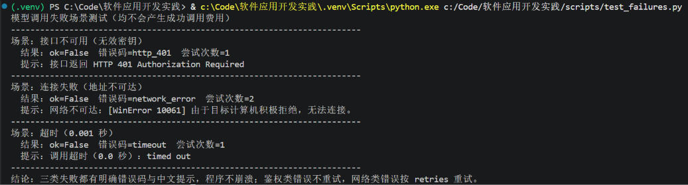
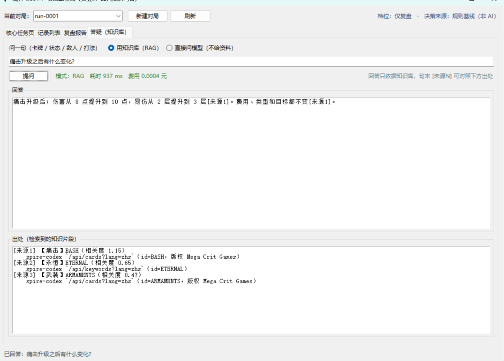
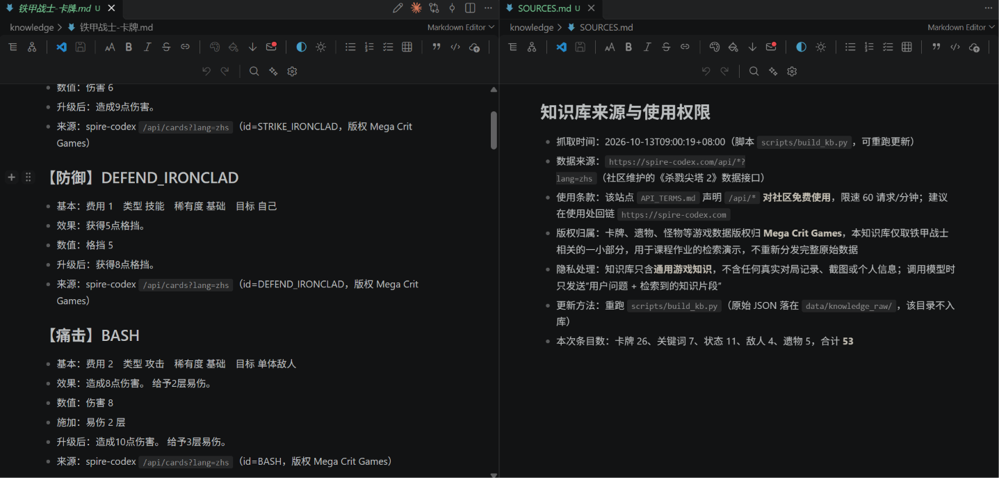
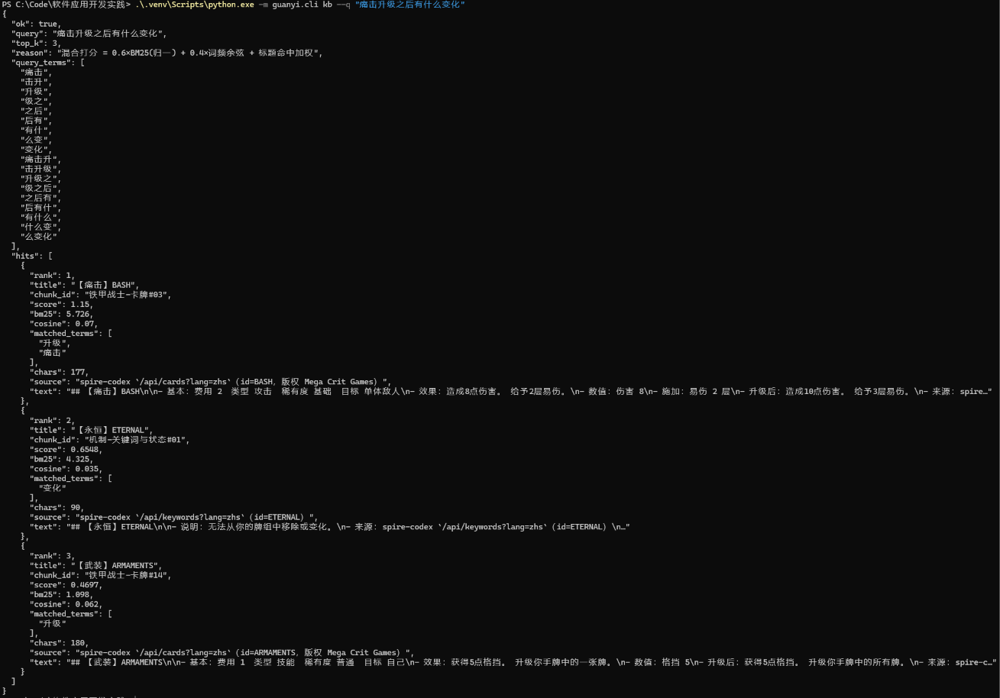
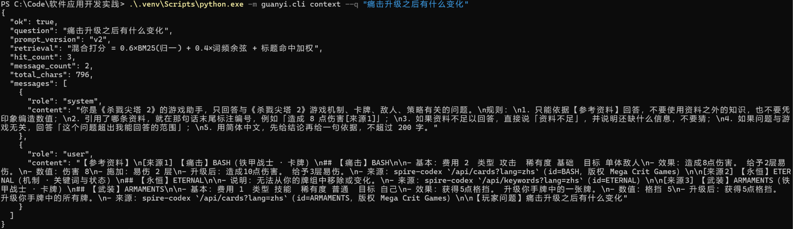
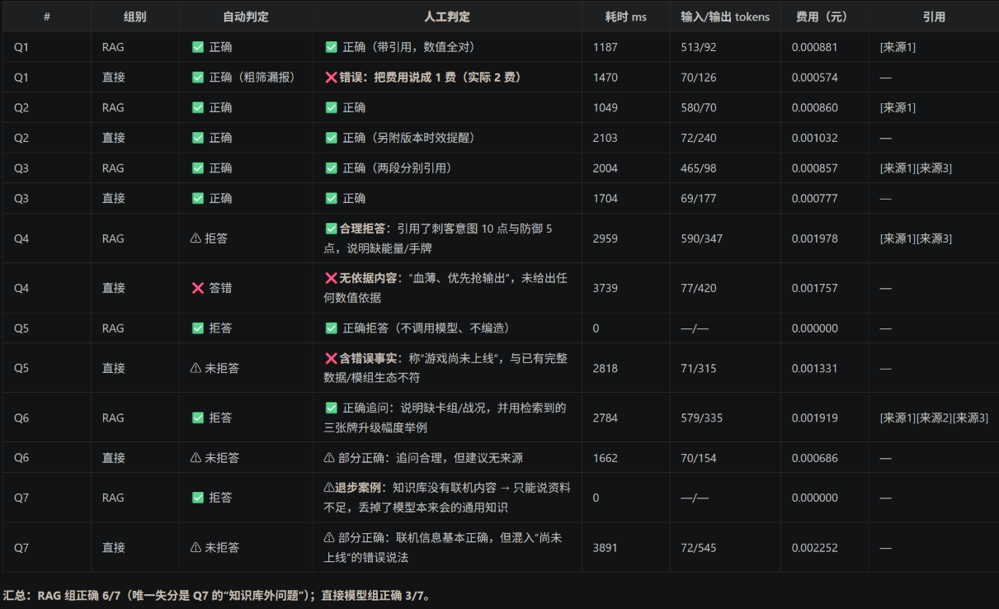
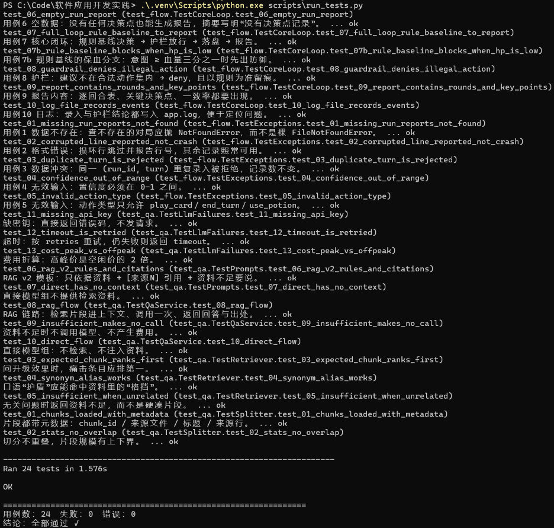
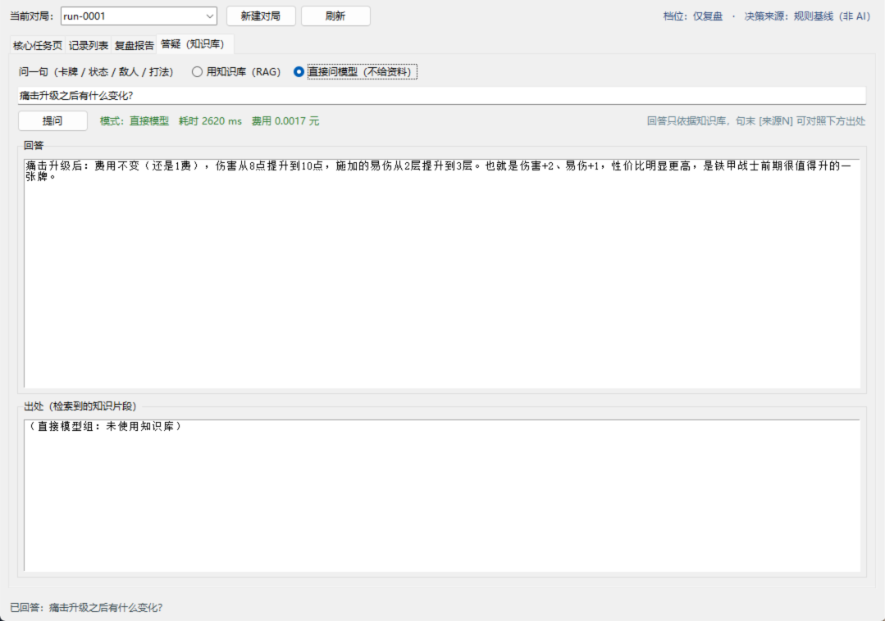

# 实验5：LLM、Context与RAG实现

## 学习通提交说明

- **提交平台：** 只向学习通对应的作业上传一份PDF文件。
- **文件命名：** 班级-学号-姓名-实验5-LLM、Context与RAG实现.pdf。
- **PDF内容：** 模型调用、Prompt修改、知识库处理、RAG运行、对比测试和实验小结，附仓库链接与Commit。
- **截止时间：** 以学习通作业设置为准。

## 1. 实验目的

- 编写并运行模型调用代码，掌握输入组织、结构化输出校验和调用失败处理。
- 完成资料切分、检索、上下文组织、回答生成与来源引用，理解RAG各环节的作用。
- 使用固定问题集对比直接调用模型与使用RAG的回答，分析效果与局限。

## 2. 实验内容

### 2.1 LLM调用与输出格式

- 选择一个知识问答任务，说明用户问题、输入内容和结果用途；结合个人软件时，注明对应个人软件的用户故事。
- 编写并运行云端模型调用代码，记录模型名称、调用方式、配置和主要参数，展示完整输入与返回结果，并测试至少一种连接失败、接口不可用或超时情况。
- 运行至少3组输入，包含正常问题、缺少必要信息的问题和超出任务范围的问题，记录期望与实际结果。缺少信息时提示补充或追问，超出范围时按任务要求提示无法处理。

### 2.2 Prompt与上下文组织

- 编写可重复使用的Prompt模板，区分任务要求和用户问题，明确回答格式及信息不足时的处理。完成RAG后加入检索资料与来源，多轮对话按需加入历史消息，并展示一份实际发送给模型的完整输入。
- 根据测试结果修改至少一次Prompt，记录原版本、修改原因、修改内容和结果变化；结论限于本次样例，未改善或出现退步也应记录。
- 检查输入中是否存在无关或重复信息，按需精简并记录检查结果；有删减时比较长度与回答变化。选择和组织模型输入信息称为上下文工程；长度可用字符数或Token数。

### 2.3 知识库与切分策略

- 根据个人软件选择少量、来源明确的资料作为知识库；记录数量、格式、使用权限和隐私处理方式，清理乱码、重复及无关内容，不得向外部模型发送敏感数据。
- 按段落、标题或长度切分文本，说明片段大小、相邻片段是否重叠以及资料更新方法。
- 抽查至少3个片段，展示内容与元数据，检查关键语句是否完整、来源是否对应原资料。发现问题时调整切分方式并重新检查。

### 2.4 检索与RAG最小链路

- 实现关键词检索、向量检索或二者结合的方法，并说明选择理由。关键词检索按词语匹配；使用向量检索时，用同一嵌入模型分别将资料片段和用户问题转为数值向量，再比较相似程度，记录模型名称与比较方法。
- 展示一次查询、按相关性排序的前k个片段（Top-k）及排序依据，说明k的取值。返回片段不代表资料相关，应说明判断方法，如关键词匹配规则、经样例检查的相似度阈值或模型判断；无结果或资料不相关时，返回资料不足提示。
- 将检索片段与来源编号加入上下文，生成带出处的回答，检查引用是否对应原片段、是否支持回答；资料不足时明确提示，不编造答案或引用。
- 完成“问题输入—检索—上下文组织—模型调用—回答返回”的流程，保存检索片段、实际上下文和最终回答。

### 2.5 对比测试与质量分析

- 建立5—8个固定问题及判断规则，包含单片段可回答、多片段综合，以及资料无答案或含义不清的情况，写明处理方式，供后续实验重复使用。
- 两组使用相同问题、模型、主要参数和基本输出格式：直接模型组不提供检索资料，RAG组增加资料及依据资料回答、引用来源的要求。说明两组提示词的差异；各次测试使用独立上下文，避免前一次结果影响后一次测试。
- 用统一表格记录两组回答和人工判断，比较正确性、要点遗漏和无依据内容，另检查RAG组的引用可靠性。资料无答案时，区分模型凭已有知识回答与资料能够支持回答。
- 记录从输入到返回结果的耗时，以及可获取的Token数或调用次数；收费接口补充实际或估算费用。

### 2.6 模块调用与后续使用

- 将检索和回答生成整理为可调用的模块，说明依赖、调用方式、输入、输出及失败返回，并提供知识库准备方法。
- 提供页面、接口或命令行入口，演示从输入问题到显示回答与出处的完整过程。
- 说明个人软件是否继续使用RAG及理由，需要时指出拟接入的功能；列出当前局限和下一步改进计划。

## 3. 操作记录

### 3.1 LLM 调用与输出格式

**调用配置**

| 项         | 取值                                                                                                               |
| ---------- | ------------------------------------------------------------------------------------------------------------------ |
| 模型       | `deepseek-flash`（DeepSeek-V4.1-Flash，OpenAI 兼容 chat/completions）                                            |
| 调用方式   | `guanyi/ai/llm_client.py`，标准库 `urllib` 直连 `POST {base_url}/chat/completions`                           |
| 密钥与地址 | 项目根目录`.env`（`DEEPSEEK_API_KEY`／`DEEPSEEK_BASE_URL`），代码不打印密钥                                  |
| 主要参数   | `temperature=0.3`、`max_tokens=800`、`timeout=60s`、`retries=2`（仅网络类错误退避重试）                    |
| 返回结构   | `LlmResult(ok, text, usage, cost, latency_ms, model, finish_reason, attempts)`；失败时 `error={code, message}` |

**失败处理实测**（三种情况都有明确错误码，不向用户抛异常栈）

| 场景                   | 构造方式                         | 实际结果                                                     |
| ---------------------- | -------------------------------- | ------------------------------------------------------------ |
| 接口不可用（鉴权失败） | 使用无效密钥                     | `code=http_401`，尝试 1 次（鉴权错误不重试），给出中文提示 |
| 连接失败               | `base_url=https://127.0.0.1:9` | `code=network_error`，尝试 2 次（按 retries 退避重试）     |
| 超时                   | `timeout=0.001s`               | `code=timeout`，尝试 1 次                                  |



图 1　三种调用失败的实测输出：鉴权失败（`http_401`）、网络不可达（`network_error`，重试 2 次）、
超时（`timeout`）分别给出不同错误码与中文提示，程序不崩溃。

**三组输入测试**

| 组别         | 输入                             | 期望                         | 实际结果                                                                                                |
| ------------ | -------------------------------- | ---------------------------- | ------------------------------------------------------------------------------------------------------- |
| 正常问题     | “痛击升级之后有什么变化？”     | 给出伤害/易伤/费用的正确变化 | ✅ “伤害从 8 点提升到 10 点，易伤从 2 层提升到 3 层，费用仍为 2[来源1]”                               |
| 缺少必要信息 | “我该升级哪张牌？”             | 追问补充（卡组/战况）        | ✅ “资料不足，无法判断……问题没说明卡组、章节、血量、面对的敌人”，并给出检索到的三张牌升级幅度作参考 |
| 超出任务范围 | “这游戏怎么联机和好友一起玩？” | 提示无法处理                 | ✅ “资料不足以回答”——知识库不含联机内容，**不调用模型、不编造**                               |



图 2　界面「答疑（知识库）」页：提问后返回带 `[来源N]` 的回答，下方列出检索片段、相关度与来源，
右上方显示模式、耗时与费用。

缺少必要信息 / 超出任务范围两种输入的实测输出

```text
# 缺少必要信息：追问并说明缺什么，同时给出资料内能对上的部分
> python -m guanyi.cli ask --q "我该升级哪张牌？"
answer: 资料不足，无法判断该升级哪张牌——问题没说明你手上的卡组、当前章节与血量、面对的敌人，
        以及这次升级是在篝火还是其他场合。仅就资料中三张牌的升级增幅看：坚毅 7→9 格挡[来源1]；
        耸肩无视 8→11 格挡并抽 1 张[来源2]；余烬 18→24 伤害[来源3]。

# 超出任务范围：资料不足且不调用模型（insufficient=true，耗时 0 ms、费用 0 元）
> python -m guanyi.cli ask --q "这游戏怎么联机和好友一起玩？"
ok: false   insufficient: true
answer: 资料不足：知识库里没有任何片段与问题匹配（资料不足）
```

### 3.2 Prompt 与上下文组织

**模板结构**：任务要求放 system 消息，用户问题与检索资料放 user 消息，二者分离、便于复用。

| 版本                   | 内容要点                                                                                                                                              | 结果                                                                                      |
| ---------------------- | ----------------------------------------------------------------------------------------------------------------------------------------------------- | ----------------------------------------------------------------------------------------- |
| v1                     | “可以结合下面的参考资料，回答不超过 200 字”                                                                                                         | 回答基本正确，但**引用不稳定**：有时不标来源，有时标 `[来源2]` 而实际用的是来源 1 |
| **v2（修改后）** | ①只能依据资料，不编造数值；②每句末尾标`[来源N]`；③资料不足直接说“资料不足”并说明缺什么；④非游戏问题回答“超出范围”；⑤先结论后依据，≤200 字 | 引用全部可对应到片段；资料不足时明确说明，不再编造                                        |

- **修改原因**：v1 的引用不稳定，无法满足 2.4 中“检查引用是否对应原片段”的要求。
- **修改内容**：见上表 ①–⑤。
- **结果变化**：7 个对照问题中，RAG 组 5 次有效调用共 8 处引用，编号全部有效（详见 `docs/实验5-对比测试.md`）。
- **结论限于本次样例**：Q7（联机问题）上 RAG 反而**退步**——它只能回答“资料不足”，丢掉了模型本来会的通用知识。

**一份实际发送给模型的完整输入**（`context` 子命令导出，共 796 字符）

```text
[system] 你是《杀戮尖塔 2》的游戏助手，只回答与《杀戮尖塔 2》游戏机制、卡牌、敌人、策略有关的问题。
规则：1. 只能依据【参考资料】回答……  2. 引用了哪条资料，就在那句话末尾标注编号，例如「造成 8 点伤害[来源1]」；
3. 如果资料不足以回答，直接说「资料不足」……  4. 如果问题与游戏无关，回答「这个问题超出我能回答的范围」；
5. 用简体中文，先给结论再给一句依据，不超过 200 字。

[user] 【参考资料】
[来源1] 【痛击】BASH（铁甲战士 · 卡牌）
- 基本：费用 2　类型 攻击　稀有度 基础　目标 单体敌人
- 效果：造成8点伤害。 给予2层易伤。
- 升级后：造成10点伤害。 给予3层易伤。
[来源2] 【永恒】ETERNAL（机制 · 关键词与状态）……
[来源3] 【武装】ARMAMENTS（铁甲战士 · 卡牌）……

【玩家问题】痛击升级之后有什么变化
```

**上下文工程检查**：RAG 组输入约 465–590 token（检索资料约占 400），直接组仅 70–77 token；
检索片段之间**没有重复信息**（每条是独立知识单元），但**存在无关片段**（问痛击时也会检索到【永恒】【武装】）。
处理方式：Top-k 固定为 3，并由 Prompt 限定“只依据资料回答”，不进一步删减——删减会牺牲多片段综合题的召回。
若把 Top-k 降到 1，Q3（易伤 + 虚弱）会因缺一半资料而答不全。

### 3.3 知识库与切分策略（对应 2.3）

| 项       | 内容                                                                                                                                                                                                  |
| -------- | ----------------------------------------------------------------------------------------------------------------------------------------------------------------------------------------------------- |
| 数量     | **53 条片段**（卡牌 26、关键词 7、状态 11、敌人 4、遗物 5）                                                                                                                                     |
| 格式     | Markdown，每条一个`## ` 标题块，每条都带“来源”行                                                                                                                                                  |
| 来源     | `https://spire-codex.com/api/*?lang=zhs`（社区维护的《杀戮尖塔 2》数据接口）                                                                                                                        |
| 使用权限 | 站点`API_TERMS.md` 声明 `/api/*` 对社区免费使用（60 请求/分钟）；**游戏数据版权归 Mega Crit Games**。本知识库只取铁甲战士相关的一小部分用于课程演示，不重新分发完整原始数据，使用处回链站点 |
| 隐私处理 | 只含通用游戏知识，**不含对局记录、截图、账号或个人信息**；调用模型时只发送“问题 + 检索片段”                                                                                                   |
| 清理动作 | ①清洗接口富文本标记（`[gold]…[/gold]`、`[energy:2]`）；②修正 id 映射（STS2 的卡牌/敌人 id 与一代不同）；③去重                                                                                 |
| 更新方法 | 重跑`scripts/build_kb.py`（原始 JSON 落在 `data/knowledge_raw/`，已被 `.gitignore` 忽略）；片段 id 由「文件名 + 序号」稳定生成                                                                  |

**切分策略**：按 `## ` 标题切分（每张卡、每个状态、每只敌人天然是一个知识单元）；
片段大小 **85–220 字符**（中位 165），**相邻片段不重叠**——重叠会让同一句话被重复检索、并在回答里重复引用。

**抽查 3 个片段**

| # | 片段 id                  | 元数据                                                    | 内容检查                                                                                               | 结论              |
| - | ------------------------ | --------------------------------------------------------- | ------------------------------------------------------------------------------------------------------ | ----------------- |
| 1 | `铁甲战士-卡牌#05`     | 【痛击】BASH；来源`/api/cards`（id=BASH）               | “效果：造成8点伤害。给予2层易伤。”+“升级后：造成10点伤害。给予3层易伤。”语句完整、数值与原数据一致 | ✅ 通过           |
| 2 | `机制-关键词与状态#08` | 【易伤】VULNERABLE；来源`/api/powers`（id=VULNERABLE）  | “受到的攻击伤害增加 50%”完整，无`[blue][Amount][/blue]` 之类残留                                   | ✅ 通过（清洗后） |
| 3 | `第一章-敌人#01`       | 【劫掠者刺客】ASSASSIN_RUBY_RAIDER；来源`/api/monsters` | 血量 18–23（进阶 19–24）；行动“致命射击 10（进阶 11）点［攻击］”，意图与伤害完整                   | ✅ 通过           |

> 抽查发现的问题与处理：第 2 条最初残留 `[blue][Amount][/blue]` 富文本标记 → 在生成脚本里加入
> `clean_text()` 清洗 → 重新生成后复检通过。



图 3　知识库的实际文件与使用权限说明：左侧是 `knowledge/铁甲战士-卡牌.md` 中的片段
（标题、费用/类型/稀有度/目标、效果、升级后、来源行），右侧 `knowledge/SOURCES.md` 记录抓取时间、
接口地址、版权归属（Mega Crit Games）与“不含对局数据”的隐私说明。

### 3.4 检索与 RAG 最小链路

**检索方式与理由**：关键词 + 词频向量的**混合检索**（`guanyi/knowledge/retriever.py`）。

- 关键词：同义词归一（“护盾→格挡”“血量→生命”）+ 中文 2/3-gram + **BM25 简化打分**；
- 向量：同一套词表构造**词频向量**并计算余弦相似度；
- 混合得分：`0.6×BM25(归一) + 0.4×余弦 + 标题命中加权`。
- **理由**：课程环境不便安装分词库与嵌入模型（DeepSeek 只提供 chat 接口），混合方案零依赖、可解释、可复核。
- **局限**：这里的“向量”是词频向量而非神经嵌入，对口语化改写的召回有限。

**一次查询的 Top-k**（k=3 的依据：片段库仅 53 条，3 条已能覆盖单片段与双片段综合；k 过大会引入无关片段、推高 token 成本）

| 排名 | 片段              | 得分  | BM25 | 余弦 | 命中词     |
| ---- | ----------------- | ----- | ---- | ---- | ---------- |
| 1    | 【痛击】BASH      | 1.150 | 5.73 | 0.07 | 痛击、升级 |
| 2    | 【永恒】ETERNAL   | 0.655 | 4.33 | 0.04 | 变化       |
| 3    | 【武装】ARMAMENTS | 0.470 | 1.10 | 0.06 | 升级       |



图 4　`kb` 子命令的检索预览：Top-3 片段、混合得分、BM25 与余弦分、命中词，排序依据可复核。

**相关性判断与“资料不足”**：阈值 `min_score=0.08`；若没有任何片段命中查询词、或最高分低于阈值，
直接返回“资料不足”且**不调用模型**（Q5、Q7 实测均为 0 次调用、0 费用）。

**带出处的回答与引用检查**：回答中的 `[来源N]` 与上下文编号一一对应；先自动检查“编号是否在范围内”，
再人工检查“被引片段是否支持该句”。本次 8 处引用全部指向真实片段。

**落盘记录**：每次问答保存到 `data/qa/qa_<时间戳>.json`，含检索片段、**实际发送的 messages**、
回答、耗时、token 与费用，界面与命令行都可复现。



图 5　`context` 子命令导出的“实际发送给模型的完整输入”：system 规则 + 带编号的检索资料 + 用户问题（不调用模型、不产生费用）。

### 3.5 对比测试与质量分析

固定问题集 7 个（单片段 Q1–Q2、多片段综合 Q3–Q4、资料无答案 Q5、缺信息 Q6、超出范围 Q7），
两组差异：

- **直接模型组**：system 只说“你是游戏助手”，user 只给问题；
- **RAG 组**：system 为 Prompt v2 的五条规则，user 给“【参考资料】+【玩家问题】”，要求 `[来源N]`；
- 同一模型、同参数（temperature 0.3、max_tokens 800），每题独立上下文。

**汇总（人工复核后；每题耗时、token 与费用的完整数据见图 6）**

| #  | 类型       | RAG 组判定                  | 直接模型组判定                        | 关键差异             |
| -- | ---------- | --------------------------- | ------------------------------------- | -------------------- |
| Q1 | 单片段     | ✅ 正确（带引用）           | ❌ 费用说成 1 费（实际 2 费）         | **数值幻觉**   |
| Q2 | 单片段     | ✅ 正确                     | ✅ 正确                               | —                   |
| Q3 | 多片段综合 | ✅ 正确（两段分别引用）     | ✅ 正确                               | —                   |
| Q4 | 多片段综合 | ✅ 合理拒答并给出已知数值   | ❌ 无依据判断（“血薄、优先抢输出”） | **无依据内容** |
| Q5 | 资料无答案 | ✅ 正确拒答（0 次调用）     | ❌ 含错误事实（称“游戏尚未上线”）   | 编造                 |
| Q6 | 缺信息     | ✅ 正确追问 + 列举升级幅度  | ⚠ 追问合理但建议无来源               | 引用可靠性           |
| Q7 | 超出范围   | ⚠ 退步：知识库外知识被丢弃 | ⚠ 信息基本正确但混入错误说法         | RAG 的范围代价       |

**合计：RAG 组 6/7 正确、直接模型组 3/7；14 次调用共 0.0149 元、平均耗时 1955 ms。**

**结论**

1. 机制/数值类问题（Q1–Q3、Q6）：RAG 更可靠——数值与知识库逐条对得上、每句有来源可回溯；直接组在 Q1 的费用上出错。
2. 资料无答案/超范围（Q5、Q7）：RAG 按设计拒答、不编造；代价是丢掉知识库外的通用知识（Q7 的退步案例，如实记录）。
3. 引用可靠性：8 处引用编号全部有效、均指向真实片段；但“引用是否足以支持结论”仍需人工判断（Q6 属列举式引用）。
4. 自动判定只能做粗筛：Q1 直接组因“2”出现在“2 层”里被判正确，人工复核才发现费用错误——**自动检查不能替代人工事实核对**。



图 6　对照实验的完整汇总表（每题两组的自动判定、人工判定、耗时、输入/输出 token 与费用）：
上面是摘要，完整逐题数据见本图与 `docs/实验5-对比测试.md`。



图 7　24 个单元测试全部通过（`unittest`）：切分、检索与同义词、资料不足、Prompt 组装、RAG 链路、
缺密钥/超时/费用折算等场景均不联网。

### 3.6 模块调用与后续使用（对应 2.6）

| 模块                              | 依赖     | 调用方式                               | 输入 → 输出                                    | 失败返回                                                          |
| --------------------------------- | -------- | -------------------------------------- | ----------------------------------------------- | ----------------------------------------------------------------- |
| `guanyi/knowledge/splitter.py`  | 标准库   | `load_chunks(kb_dir)`                | 知识库目录 → 片段列表（含元数据）              | 目录不存在返回空列表                                              |
| `guanyi/knowledge/retriever.py` | splitter | `Retriever().search(q, top_k)`       | 问题 →`{ok, hits[得分/命中词/片段], reason}` | 无匹配 →`ok=False` + “资料不足”                              |
| `guanyi/ai/llm_client.py`       | 标准库   | `LlmClient().chat(messages)`         | messages →`LlmResult`                        | `http_401`／`network_error`／`timeout`／`missing_api_key` |
| `guanyi/ai/prompts.py`          | 标准库   | `build_messages(q, hits, version)`   | 问题+片段 → messages                           | —                                                                |
| `guanyi/app/qa_service.py`      | 以上模块 | `QaService().ask(q, use_rag, top_k)` | 问题 → 回答+出处+用量+费用，并落盘 JSON        | 资料不足 →`insufficient=True` 且不调用模型                     |

**知识库准备方法**：`python scripts/build_kb.py`（抓取 → 清洗 → 生成 `knowledge/*.md` 与 `knowledge/SOURCES.md`）。

**入口**

```powershell
python -m guanyi.cli kb --q "护盾怎么算的"                       # 检索预览（Top-k 与排序依据）
python -m guanyi.cli ask --q "痛击升级之后有什么变化"              # RAG 问答（带出处）
python -m guanyi.cli ask --q "痛击升级之后有什么变化" --no-rag     # 直接模型组（对照）
python -m guanyi.cli context --q "痛击升级之后有什么变化"           # 导出实际发送的完整输入
python scripts/run_qa_eval.py                                   # 跑全部对照实验并生成表格
```

界面入口：主窗口新增「答疑（知识库）」页（图 1、图 2），可选“用知识库（RAG）”或“直接问模型”。



图 8　同一问题切到“直接问模型（不给资料）”的对照：回答不再有出处，且出现与知识库冲突的数值。

**是否继续使用 RAG**：**继续使用**，但只用于**解释层**（回答“为什么这样打更好”，对应 US-01），
不用于决策层——决策仍必须是“截图 → 模型”，避免把对局数据放进上下文、破坏跨游戏适用性。
拟接入位置：核心任务页的“为什么这么建议”按钮（用与建议动作相关的知识作答）。

**局限与下一步**：① 检索仍是轻量方案（无嵌入向量），对口语化改写召回有限；② 引用只做到“编号有效、片段可对应”，
未逐句核验；③ 知识库仅覆盖铁甲战士 + 第一章，Q5 类问题只能拒答；④ 下一步：为“为什么这么建议”做专用检索
（把建议动作与卡牌条目关联），并尝试加入嵌入向量做混合检索对比。

## 4. 实验小结

**做了什么**：在实验4 的非 AI 闭环之上新增**知识问答**能力——从《杀戮尖塔 2》社区数据接口生成 53 条片段的
知识库，实现“同义词 + BM25 + 词频余弦”的混合检索，用 Prompt v2 约束“只依据资料、标注来源、资料不足要说”，
并把检索片段、实际上下文与回答完整落盘。

**关键数据**：知识库 53 条（85–220 字符/条、不重叠）；7 个固定问题 × 2 组共 14 次调用，
RAG 组正确 **6/7**、直接模型组 **3/7**；总费用 **0.0149 元**、平均耗时 **1955 ms**；
三种调用失败（鉴权/网络/超时）都有明确错误码；24 个单元测试全部通过。

**关键判断**：① 用公开数据接口而不是手抄 wiki，兼顾“来源明确”与工作量；
② 用词频向量而不是嵌入模型，是因为本机不便安装依赖、DeepSeek 也无嵌入接口——如实标注为“词频向量”；
③ RAG 只用于解释层、不进决策上下文，守住“决策只读画面”的边界（需求说明 C3）。

**如实记录的退步**：Q7（联机问题）上 RAG 只能回答“资料不足”，而直接组给出了基本正确的答案——
说明 RAG 用“可信”换来了“范围受限”，这也是后续要引入“知识库外问题回退通用问答”的原因。

**局限**：检索无嵌入向量、引用未逐句核验、知识库覆盖范围小、界面还没有“点击建议→解释”的联动；
这些与实验6 的评测计划一起作为下一步改进。
