# 实验6：工具调用、Agent与Harness实现

## 学习通提交说明

- **提交平台：** 只向学习通对应的作业上传一份PDF文件。
- **文件命名：** 班级-学号-姓名-实验6-工具调用、Agent与Harness实现.pdf。
- **PDF内容：** 任务说明、工具接口、Agent、Harness、执行日志和实验小结，附仓库链接与Commit。
- **截止时间：** 以学习通作业设置为准。

## 1. 实验目的

- 掌握工具接口定义、参数验证、权限边界和结果反馈。
- 实现一个由模型根据任务和工具结果决定下一步操作、运行状态可查看且能够终止的单Agent。
- 编写运行时Harness，完成上下文组织、工具执行、结果检查、停止控制和日志记录。

## 2. 实验内容

### 2.1 任务选择与边界

- 结合个人软件选择一个范围较小、结果能够检查的任务，如查询样例数据后生成统计结果；不适合接入个人软件时，可独立完成练习。
- 列出任务目标、可用数据、工具、停止条件和成功标准，并给出一组输入及预期结果。本实验实现单Agent，由模型根据目标和工具结果决定下一步操作；说明哪些步骤由程序预设，哪些由模型决定。
- 说明哪些操作允许自动执行，哪些必须用户确认，哪些明确禁止。

### 2.2 工具接口与参数约束

- 实现至少2个可实际运行的工具，如读取样例文件、查询数据或执行统计计算，说明名称、用途、输入字段、类型、必填项、返回结果和错误信息。输入格式及字段约束也称Schema。
- 建立允许调用的工具列表，执行前由程序检查工具名称、参数和访问范围，例如数值范围、允许的文件目录或可访问的数据；不能直接执行模型生成的任意函数名或命令。
- 说明工具的最长等待时间、是否修改数据，以及重复调用是否会产生重复修改；在接入Agent前，直接测试至少一次正确参数和一次错误参数。

### 2.3 Agent循环与状态

- 绘制“接收目标—模型提出调用请求—程序检查并执行工具—回传工具结果—模型继续或给出最终回答”的循环图，标出参数校验、人工确认和停止检查的位置。
- 接入支持工具调用的模型接口，或约定可由程序解析的JSON调用格式，实际运行模型与工具之间的循环。模型提出工具名称和参数，程序负责执行；将调用请求和对应工具结果按接口要求加入后续上下文，不能只把结果打印出来。
- 设置最大执行步数、模型与工具调用超时、总运行时限及重试上限，说明一步如何计数，并由程序执行限制。模型给出最终回答后，还应检查结果是否满足2.1的成功标准，不能仅凭模型声称完成就判定成功。

### 2.4 运行时Harness设计与实现

- 将组织模型与工具运行的外围程序作为本实验的运行时Harness，说明任务输入、上下文、执行、结果检查和日志分别由哪些函数或模块负责，不要求拆成多个独立服务。
- 实现模型调用、工具分发、参数与权限检查、结果回传和停止控制；保留当前任务需要的输入、调用记录及工具结果。关键限制必须由程序执行，不能只写在提示词中。
- 工具失败或结果不符合要求时，将错误信息反馈给模型进行有限次修正，或结束任务并说明原因。可以使用开发框架或自行编写代码，但须说明实际控制流程，不要求多Agent或复杂框架。

### 2.5 失败处理与可观测性

- 为每次运行设置任务编号，记录时间、调用的工具与参数摘要、工具结果、错误类型、执行步数、耗时和最终状态；密钥和个人信息须遮挡或省略。
- 处理参数错误、工具异常、超时和达到步数上限等情况，返回明确状态和原因。超时可能只是停止等待，不代表后台工具已停止，应说明实际取消能力；可能修改数据的调用状态不明时，先核对执行结果，不得直接重试。
- 对需要确认的操作，在执行前展示操作内容与影响，由用户明确同意后执行；拒绝或等待超时则不执行。

### 2.6 测试与结果分析

- 至少测试5类情况：正常完成、参数错误、工具异常、达到步数或时间限制、人工确认。其中人工确认分别检查同意与拒绝；异常与边界情况可模拟触发，正常流程必须实际调用模型和工具。
- 用表格记录输入、预期行为、实际结果和判断依据，检查任务是否完成、错误是否正确反馈、停止与确认规则是否生效；未符合预期时，分析问题出在模型决策、参数、工具、检查规则还是控制流程。
- 说明Agent及运行时Harness是否用于个人软件，以及当前局限和改进计划；在个人GitHub/Gitee仓库保存工具、Agent、Harness、测试代码和运行说明，报告注明路径及对应Commit。

## 3. 操作记录

### 3.1 任务选择与边界（对应 2.1）

| 项       | 内容                                                                                                                                                                                         |
| -------- | -------------------------------------------------------------------------------------------------------------------------------------------------------------------------------------------- |
| 任务目标 | “分析 run-0001 这一局：查出决策点数、建议与实际操作的一致率、哪些回合不一致，需要时查知识库解释，最后写出复盘报告并给出结论”                                                               |
| 可用数据 | `data/runs/<run_id>/` 下的对局记录（`run.json`、`decisions.jsonl`）；`knowledge/` 下的 STS2 知识片段（53 条）                                                                        |
| 工具     | `list_runs`、`get_decisions`、`compute_stats`、`query_knowledge`、`write_report`（详见 3.2）                                                                                       |
| 停止条件 | 模型给出最终回答且通过程序校验 / 达到最大步数（8）/ 总时限（120 s）/ 连续工具错误达到 2 次                                                                                                   |
| 成功标准 | 结论按字段明确写出**决策点数、一致率、不一致回合号**，数值与 `compute_stats` 一致；任务中的对局编号与统计结果一致；写报告成功时，还检查对局编号、文件存在及 SHA-256 与写入返回值一致 |

**一组输入与预期结果**：输入为上面的任务目标；预期是 Agent 至少调用 `compute_stats`，
读到 `decision_count=3`、`consistent_rate=66.7`、`inconsistent_turns=[3]`，结论中包含这三个数字，
并（经确认后）写出报告。

**哪些由程序预设、哪些由模型决定**

| 步骤                                                                                   | 归谁                                           |
| -------------------------------------------------------------------------------------- | ---------------------------------------------- |
| 任务输入、工具白名单与 Schema、参数/路径校验、步数与时限、人工确认、成功校验、运行记录 | **程序预设**（全部写死在代码里，见 3.4） |
| 先调哪个工具、查询什么知识、是否写报告、什么时候给出结论、结论怎么写                   | **模型决定**                             |

**允许 / 必须确认 / 明确禁止**

| 类别         | 内容                                                                                                                                                                                                                               |
| ------------ | ---------------------------------------------------------------------------------------------------------------------------------------------------------------------------------------------------------------------------------- |
| 允许自动执行 | 4 个只读工具：`list_runs`、`get_decisions`、`compute_stats`、`query_knowledge`                                                                                                                                             |
| 必须用户确认 | `write_report`（覆盖写 `data/runs/<run_id>/report.md`）                                                                                                                                                                        |
| 明确禁止     | 游戏动作注入、访问工具声明范围外的文件、执行模型给出的任意函数名或命令、读取游戏进程内存。允许范围：读取 `data/runs` 与 `knowledge`；经确认写 `report.md`，运行记录写 `data/agent`，业务日志沿用 `data/runs/.../app.log` |

### 3.2 工具接口与参数约束（对应 2.2）

| 工具                 | 用途           | 输入字段（类型 / 必填 / 约束）                                  | 返回                                                                     | 错误                                          | 最长等待 | 改数据                     | 重复调用                                             |
| -------------------- | -------------- | --------------------------------------------------------------- | ------------------------------------------------------------------------ | --------------------------------------------- | -------- | -------------------------- | ---------------------------------------------------- |
| `list_runs`        | 列出对局       | 无                                                              | `{count, runs[]}`                                                      | —                                            | 20 s     | 否                         | 结果相同                                             |
| `get_decisions`    | 读逐回合决策点 | `run_id: string / 必填 / ^run-[A-Za-z0-9_-]{1,30}$`           | `{decisions[], problems[]}`                                            | `not_found`、`invalid_argument`           | 20 s     | 否                         | 结果相同                                             |
| `compute_stats`    | 算复盘统计     | `run_id`（同上）                                              | `{decision_count, consistent_rate, inconsistent_turns, hp_lost_total}` | 同上                                          | 20 s     | 否                         | 结果相同                                             |
|  `query_knowledge` | 查 STS2 知识   | `question: string / 必填`、`top_k: integer / 1–5 / 默认 3` | `{hits[]}`；无结果时 `{ok:true, insufficient:true}`                  | `invalid_argument`、`out_of_range`        | 20 s     | 否                         | 结果相同                                             |
| `write_report`     | 写复盘报告     | `run_id`（同上）                                              | `{path, decision_count, overwritten, sha256}`                          | `not_confirmed`、`not_found`、`timeout` | 30 s     | **覆盖写 report.md** | 覆盖同一文件，不新增对局或决策记录；生成时间可能更新 |

**白名单与执行前检查（程序执行）**：模型只能调用注册表里的 5 个工具名；未知名字直接返回
`unknown_tool`；每个参数按 Schema 校验类型、必填、取值区间与正则；`run_id` 正则通过后才由存储层拼路径，
因此 `../../etc/passwd` 这类参数在校验阶段就被拒绝。

**接入 Agent 前的直接测试**（`python scripts/test_tools.py`）：5 个工具的正确参数全部 OK；
错误参数分别得到 `not_found`、`invalid_argument`、`missing_argument`、`out_of_range`、`unknown_tool`、`unknown_argument`。

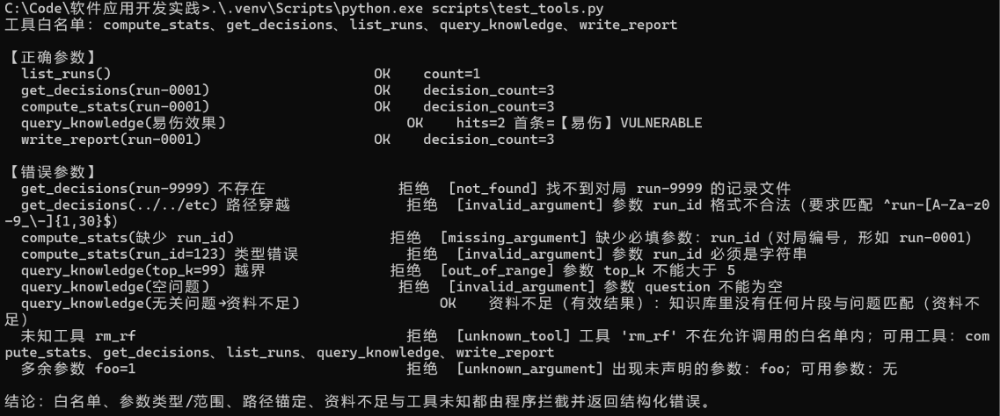

图 1　工具层直接测试：上半部分为正确参数（5 个工具均 OK），下半部分为错误参数被程序拦下并给出结构化错误码。

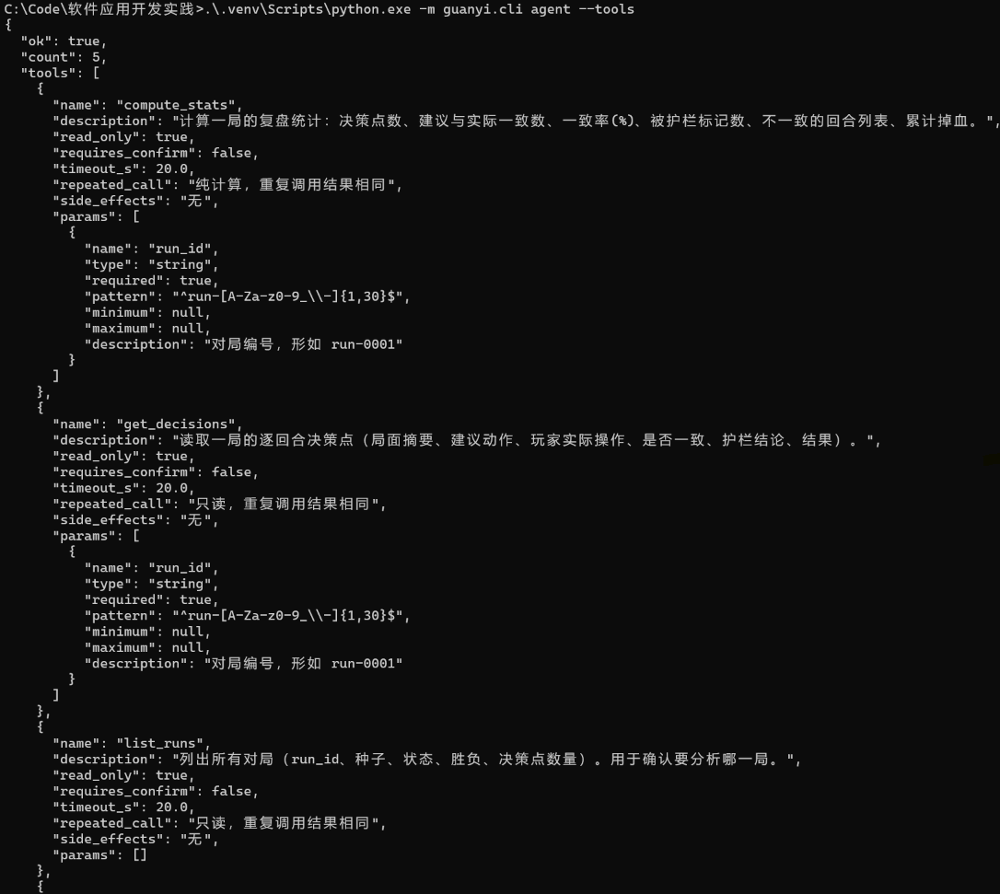

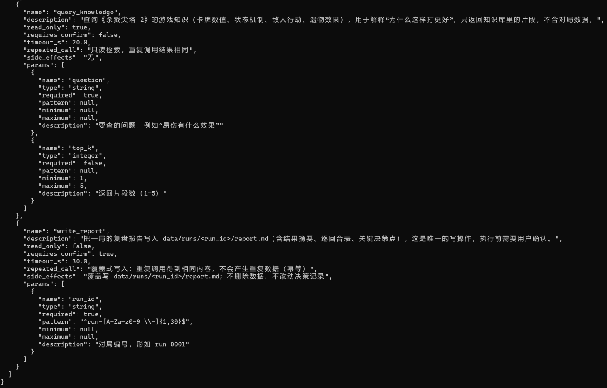

图 2　工具白名单与参数 Schema（`python -m guanyi.cli agent --tools`）：1/2 为只读工具
`compute_stats`、`get_decisions`、`list_runs`；2/2 为 `query_knowledge` 与写操作 `write_report`
（可见 `read_only: false`、`requires_confirm: true`、覆盖写与幂等说明）。

### 3.3 Agent 循环与状态（对应 2.3）

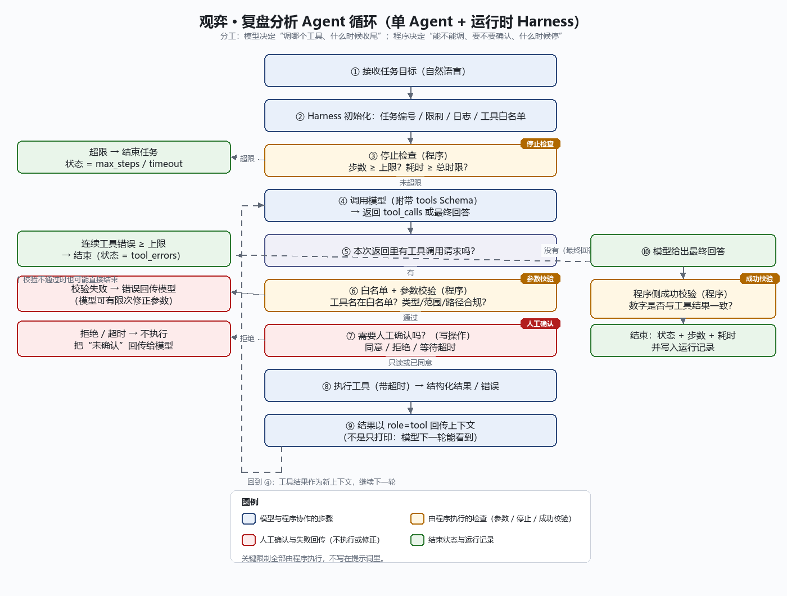

图 3　复盘分析 Agent 的循环：① 接收目标 → ② Harness 初始化 → ③ 停止检查 → ④ 模型调用（附带 tools Schema）
→ ⑤ 有工具调用？→ ⑥ 白名单与参数校验 → ⑦ 人工确认（写操作）→ ⑧ 执行工具 → ⑨ 结果以 `role=tool` 回传上下文
→ 回到 ③ 停止检查；若 ⑤ 为否 → ⑩ 最终回答 → 程序侧成功校验 → 结束。黄色为程序执行的检查，红色为人工确认与失败回传。
图中“回到④”是初始示意的简写，实际实现每轮都会先检查③；⑧的工具等待超时已在补充复核中落实。

**接口与回传**：使用 `deepseek-flash` 的原生工具调用（OpenAI 兼容 `tools` 字段）。
模型的 `tool_calls` 以 `assistant` 消息写回上下文，每个工具结果以 `role=tool`（带 `tool_call_id`）写回，
**不是只打印结果**——模型下一轮能看到工具输出并据此继续。

**限制与计数规则（由程序执行）**

| 限制             | 取值                | 说明                                                                                                     |
| ---------------- | ------------------- | -------------------------------------------------------------------------------------------------------- |
| 最大执行步数     | 8                   | **一步 = 一次模型调用**；同一步内模型请求的多个工具调用合并处理，不额外计步                        |
| 单步工具调用数   | 3                   | 仅执行前 3 个；其余调用逐条回传 `tool_call_limit`，保证每个 `tool_call_id` 都有对应结果              |
| 模型调用超时     | 60 s                | 单次模型步骤的等待预算，包含网络重试；同时受剩余总时限约束                                               |
| 模型重试上限     | 2 次                | 最多 3 次网络尝试，退避 1.5 / 3 s；剩余预算不足时停止重试                                                |
| 工具执行超时     | 20 s（写报告 30 s） | 超时即放弃等待并返回 `timeout`                                                                         |
| 总运行时限       | 120 s               | 单调时钟计时；模型、工具、确认与最终校验使用剩余预算，各阶段前后检查；到期不再开始后续工具或接受成功结果 |
| 连续工具错误上限 | 2                   | 连续失败 2 次即结束，状态 `tool_errors`                                                                |

**成功校验（不凭模型自称完成）**：Harness 按“决策点数：N；一致率：R%；不一致回合：T”
提取字段并比较数值与完整回合集合，不以数字子串出现作为依据；无不一致回合时必须明确写“无”。
任务明确指定一局时还核对对局编号；写报告成功后，检查报告所属对局、文件存在及内容 SHA-256。
任一项不通过 → `validation_failed`；缺字段、30误充3、第13回合误充第3回合、报告丢失或被替换均有回归测试。

### 3.4 运行时 Harness 设计与实现（对应 2.4）

| 环节     | 负责模块/函数                                     | 说明                                                                     |
| -------- | ------------------------------------------------- | ------------------------------------------------------------------------ |
| 任务输入 | `AgentHarness.run(goal)`                        | 目标写成一条 user 消息；system 提示词只描述协作方式                      |
| 上下文   | `run()` 里的 `messages` 列表                  | system + 目标 + assistant(tool_calls) + 每条工具结果；每步整体回传给模型 |
| 执行     | `_execute()` + `ToolRegistry.call()`          | 白名单 → 参数校验 → 人工确认 → 执行 → 结构化结果                     |
| 结果检查 | `validate_success()`                            | 数字一致性与报告落盘检查                                                 |
| 日志     | `Trace.event()`                                 | 每个事件写 JSONL + 人类可读日志（见 3.5）                                |
| 停止控制 | `run()` 各阶段与 `runtime.wait_call()`        | 步数、总时限、连续错误检查，以及模型/工具/确认的有界等待                 |
| 确认     | `confirm.py` 的 `CliConfirm` / `GuiConfirm` | 展示工具、参数、目标文件与影响；拒绝或超时→不执行                       |

关键限制由程序执行；补充复核后共 27 个 Agent 单测。提示词约定结论格式，校验与限制不依赖模型自觉遵守。

### 3.5 失败处理与可观测性（对应 2.5）

**运行记录**：每次运行有任务号（如 `task-20261027_085539`），写两份文件
`data/agent/<任务号>.jsonl`（逐事件）与 `.log`（人类可读），字段包括：时间、事件类型、工具名与参数摘要、
工具结果摘要、错误类型、执行步数、耗时、最终状态；密钥用 `sk-***` 遮挡，长文本截断 200 字。

【日志 1】历史真实运行 `task-20261027_085539`（4 步，10,053.6 ms，状态 succeeded；当时的成功校验版本）

```text
[08:55:39] 开始任务 task-20261027_085539：分析 run-0001 这一局…
[08:55:39] 第 1 步：请求模型（上下文 2 条消息）
[08:55:40] 第 1 步：模型请求调用工具 ['compute_stats', 'get_decisions', 'list_runs']
[08:55:40]   工具 compute_stats 返回：{"ok": true, "decision_count": 3, "consistent_rate": 66.7,
                                     "inconsistent_turns": [3], "hp_lost_total": -25, …}
[08:55:42] 第 2 步：模型请求调用工具 ['query_knowledge', 'query_knowledge']
[08:55:42]   工具 query_knowledge 返回：【防御】DEFEND_IRONCLAD（score 1.0865）…
[08:55:44] 第 3 步：模型请求调用工具 ['write_report']
[08:55:44]   需要确认：write_report {"run_id": "run-0001"} → 自动同意（演示用 --yes）
[08:55:44]   工具 write_report 返回：{"path": "data\\runs\\run-0001\\report.md", "overwritten": true}
[08:55:49] 第 4 步：模型给出最终回答（928 字）
[08:55:49] 结果校验：通过（全部通过）
[08:55:49] 结束任务 task-20261027_085539：状态=succeeded，步数=4，耗时=10054 ms
```

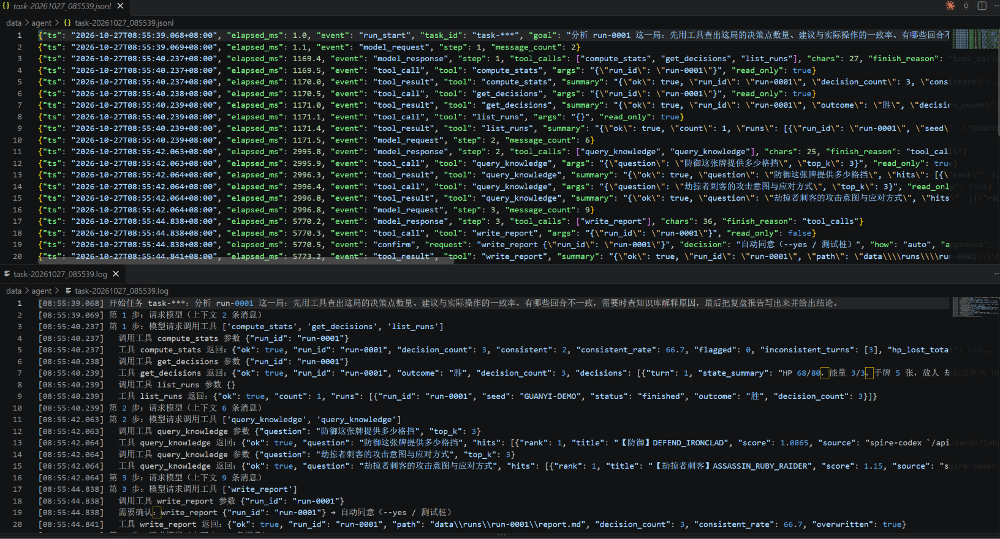

图 4　运行记录文件：上为 `.jsonl`（逐事件结构化记录），下为 `.log`（人类可读事件流），可按文件名中的任务号回溯每一步。
截图来自旧批次 `085539`；其中 `task-***` 是修复前遮挡误伤的历史记录，
正文日志为便于阅读的摘录，恢复了任务号。文件原始结尾耗时为 10,053.6 ms，约 10,054 ms。

**异常与边界**

| 情况                            | 状态/错误码                                                  | 处理                                                   |
| ------------------------------- | ------------------------------------------------------------ | ------------------------------------------------------ |
| 参数错误（格式/类型/越界/缺参） | `invalid_argument`／`out_of_range`／`missing_argument` | 不执行工具，错误回传模型，可有限次修正                 |
| 未知工具名                      | `unknown_tool`                                             | 直接拒绝，不按名字执行任何东西                         |
| 工具内部异常                    | `tool_failed`                                              | 捕获并回传，不崩                                       |
| 达到步数 / 总时限               | `max_steps` / `timeout`                                  | 结束并给明确状态                                       |
| 连续工具错误                    | `tool_errors`（≥2 次）                                    | 结束并说明原因                                         |
| 用户拒绝或确认超时              | `not_confirmed`                                            | 不执行写操作，把“未确认”回传模型                     |
| 结论与工具结果不一致            | `validation_failed`                                        | 不放行，记录未通过项                                   |
| 写入等待超时或执行结果不明      | `write_state_unknown`                                      | 结束任务并提示核对；同一数据目录在本进程中禁止继续写入 |

**关于超时的取消能力**：模型调用超时只是**停止等待**，请求已在服务端发出，无法保证服务端已停止处理；
工具通过守护线程执行，等待到期会返回，但无法强制终止正在运行的线程。读工具超时可以把错误反馈给模型；
写工具超时则立即以 `write_state_unknown` 结束，不自动重试，并阻止本进程对同一数据目录继续写入。
恢复步骤为：关闭观弈进程以结束本地后台线程，检查目标报告的存在、内容和哈希，再决定是否重新启动并确认写入。
`test_11/12` 只验证执行前拒绝与确认超时；新增 `test_18` 验证执行中超时后不重试，且后台仍可能完成写入。

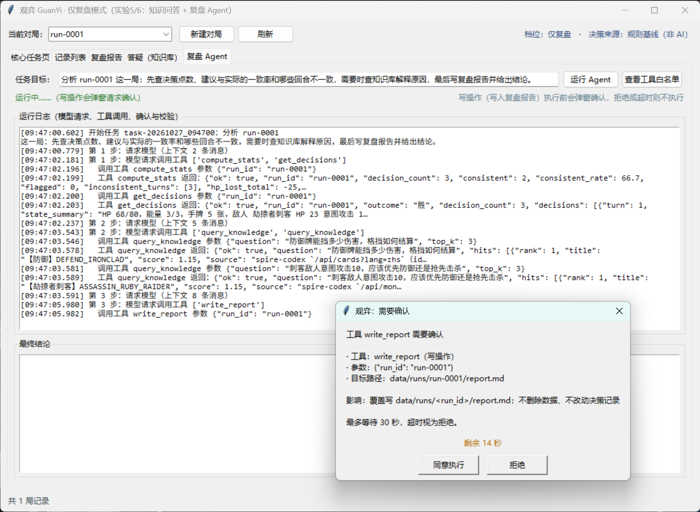

图 5　写操作的人工确认：弹窗展示工具名、参数、目标路径与影响（覆盖写 `report.md`），
倒计时 30 秒，点“拒绝”或超时都不执行。

### 3.6 测试与结果分析（对应 2.6）

五类场景的完整记录（输入、预期、实际、判断依据）见 [`docs/实验6-测试记录.md`](docs/实验6-测试记录.md)，摘要：

| 场景          | 预期                          | 实际                                             | 判断依据                                 |
| ------------- | ----------------------------- | ------------------------------------------------ | ---------------------------------------- |
| 正常完成      | 调用工具 → 结论 → 校验通过  | ✅ `succeeded`（单测 3 步；历史真实运行 4 步） | 当前单测 + 历史真实运行日志              |
| 参数错误      | 拦下并回传，模型修正          | ✅ 首次 `invalid_argument`，第二次成功         | 单测 `test_02`/`test_08`             |
| 工具异常      | 捕获成 `tool_failed`，不崩  | ✅ 后续步骤继续                                  | 单测 `test_03`                         |
| 达到步数/时限 | 程序停止并给状态              | ✅ `max_steps` / `timeout`                   | 单测 `test_04`/`test_05`             |
| 人工确认      | 同意→执行；拒绝/超时→不执行 | ✅ 三种结果都验证                                | 单测 `test_10`/`test_11`/`test_12` |

**未符合预期的情况与归属**（详见测试记录第五节）：UI 冒烟里 Agent 校验未通过 → **测试夹具**问题（临时目录没有 `run-0001`）；
日志任务号被遮成 `task-***` → **日志/实现**问题（遮挡正则误伤，已修正）；“资料不足”被当作工具错误 →
**检查规则**问题（改为有效结果）。三类问题分别定位到了夹具、实现与规则，而不是笼统归因于模型。

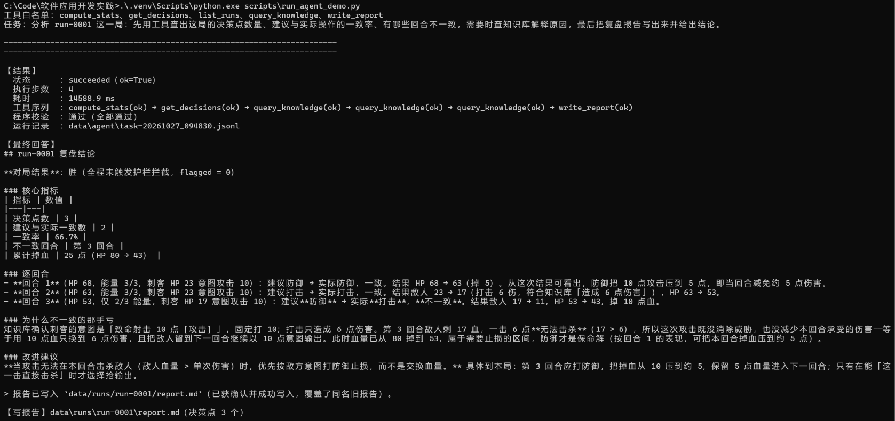

图 6　真实模型 + 真实工具的完整运行（`python scripts/run_agent_demo.py`）：状态 succeeded、4 步、
截图对应 `task-20261027_094830`，耗时 **14,588.9 ms**，工具序列
`compute_stats → get_decisions → query_knowledge×3 → write_report`，共 6 次调用，旧版程序校验通过。
这是与日志1不同的一次运行，保留原图；修复后的更严格检查由新增回归测试验证。

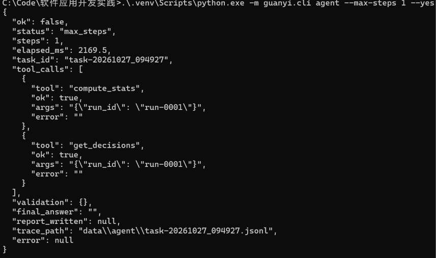

图 7　停止与失败场景：达到步数上限时 Agent 立即结束（状态 `max_steps`），参数错误/未知工具被拦下并回传错误码。

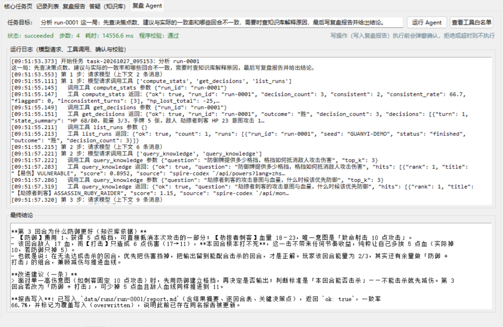

图 8　界面「复盘 Agent」页：输入任务目标后运行，日志区实时显示每一步的模型请求、工具调用、确认与校验，
下方显示最终结论，状态栏显示状态、步数、耗时与程序校验结果。
图8为另一批次 `task-20261027_095153`，4步、14,556.6 ms；并非图6或日志1的同一次运行。

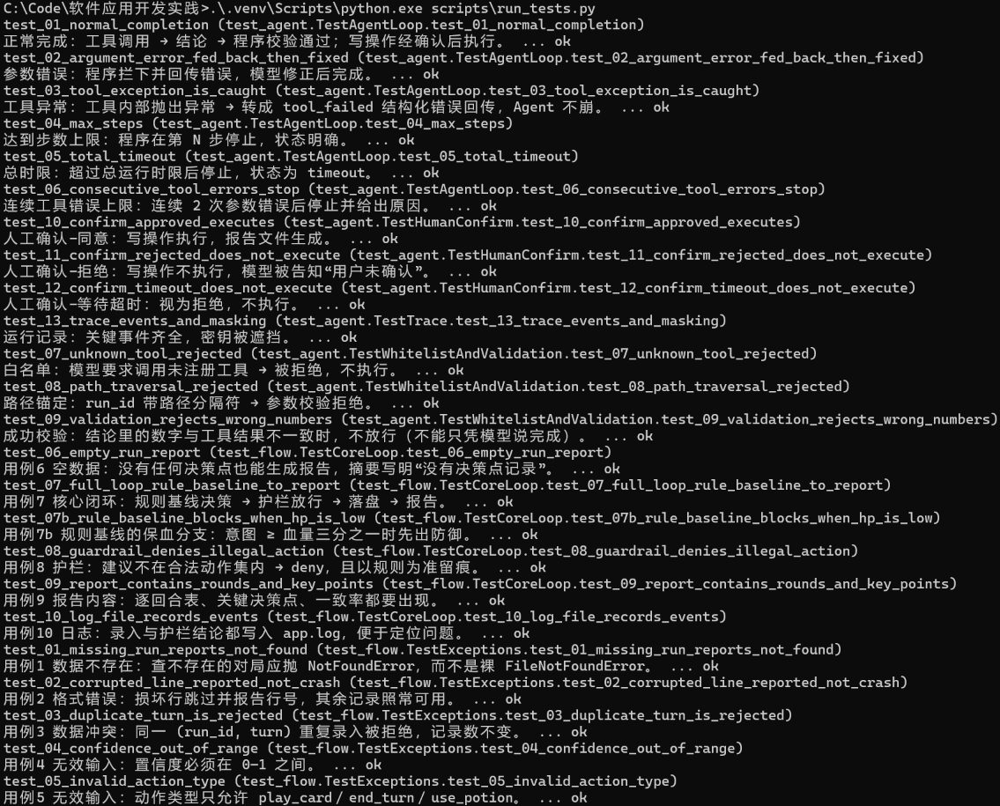

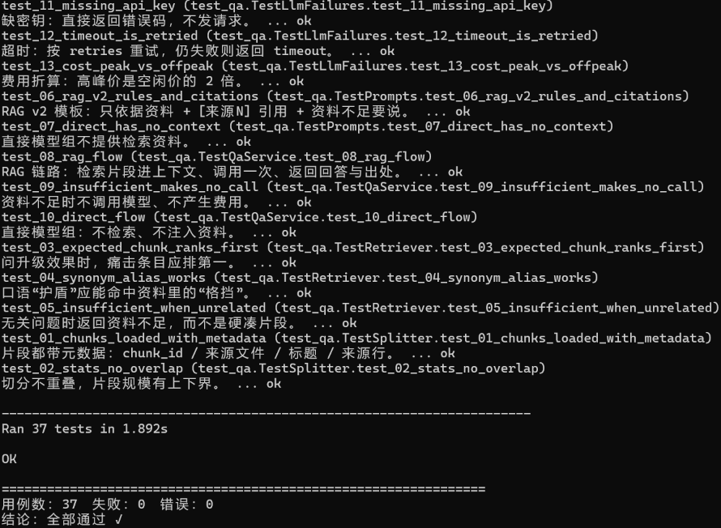

图 9　自动化测试（`python scripts/run_tests.py`）：1/2 为 Agent 的 13 个用例与实验4 的部分用例，
2/2 为其余用例与汇总——共 **37 个用例全部通过**（不联网、不花钱）。
该图保留历史测试结果。2026-11-03 补充 14 个 Agent 回归用例后，当前共 **51 个用例全部通过**
（Agent 27、实验4 11、实验5 13）；在临时目录中复测，不使用真实模型，不要求更新截图。
另外实际驱动GUI确认的同意、拒绝、倒计时超时三种结果，并完成五页界面冒烟，Agent显示 `succeeded`、程序校验通过。

**是否用于个人软件**：是——Agent 面向观弈的“复盘分析”场景，直接使用实验4 的对局数据与实验5 的知识库。
**当前局限**：① 成功校验是规则级（数字与字段），不是语义级判断；② 超时无法强制中断远端调用；
③ 单 Agent、无长期记忆与多轮规划；④ 工具仅 5 个，尚未接入截图识别与动作执行。
**改进计划**：把 `query_knowledge` 升级为实验5 的完整 RAG（带引用回答），
并接入“为什么这么建议”的专用检索；在实验6 的 Harness 之上再引入记忆（对应实验3 的 I-8）。

## 4. 实验小结

**做了什么**：在观弈上实现了**复盘分析单 Agent + 运行时 Harness**——5 个受控工具（4 只读 + 1 写）、
原生 `tool_calls` 循环、白名单与参数/路径校验、人工确认、步数/时限/连续错误限制、程序侧成功校验，
以及按任务号落地的运行记录（密钥遮挡）。

**关键数据**：当前 27 个 Agent 单元测试，加上实验4/5 共 **51 个，全部通过**；
历史真实运行 `085539` 为 4 步、约 10,054 ms、6 次工具调用（含 1 次自动同意的演示写操作），旧版校验通过。
五类场景均有自动化用例；人工确认验证“同意执行，拒绝或确认超时不执行”。
新增回归验证工具/模型/总时限、写入状态不明、字段数字与报告文件检查；没有将旧截图冒充为修复后的真实模型运行。

**关键判断**：① 限制必须写在代码里并配测试，而不是写进提示词；② “资料不足”是有效结果而不是工具错误，
这个口径直接决定了 Agent 会不会被误判为连续失败；③ 成功校验由程序做，避免“模型说完成了”就放过；
④ 写操作走人工确认，并且选择幂等的覆盖写，降低“状态不明”的风险。

**局限**：校验为规则级、超时不可强制中断、单 Agent 无记忆、工具未覆盖视觉与执行；
下一步把 Harness 与实验5 的 RAG、实验3 的记忆接口接起来，形成“读懂局面 → 解释 → 复盘 → 记住”的闭环。
