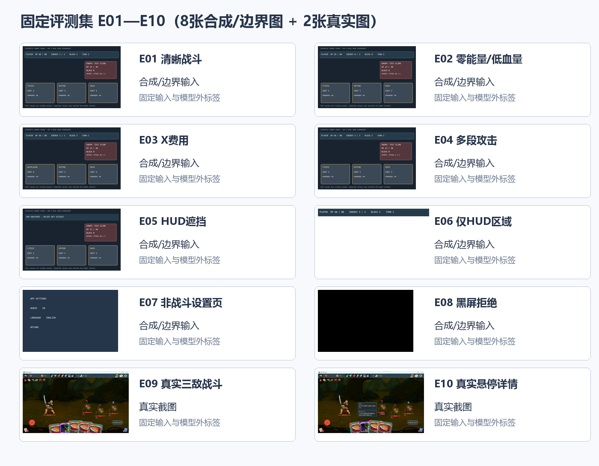
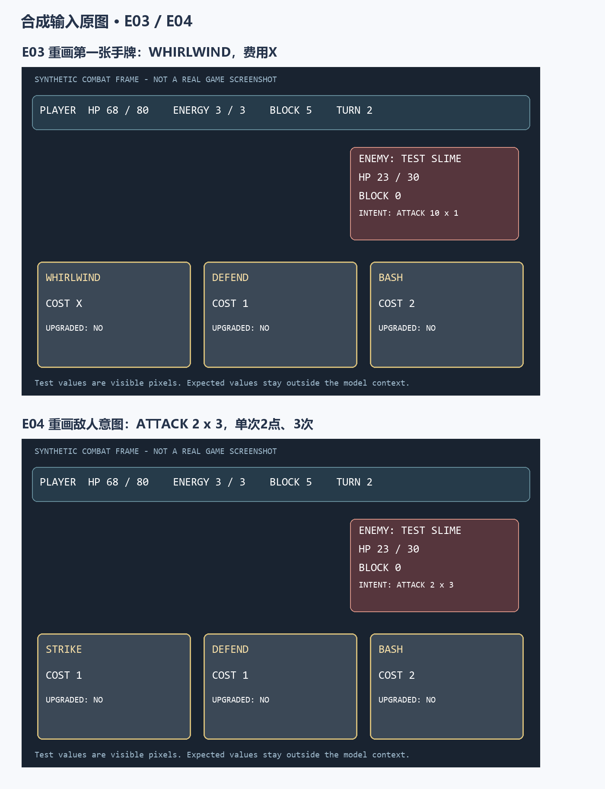
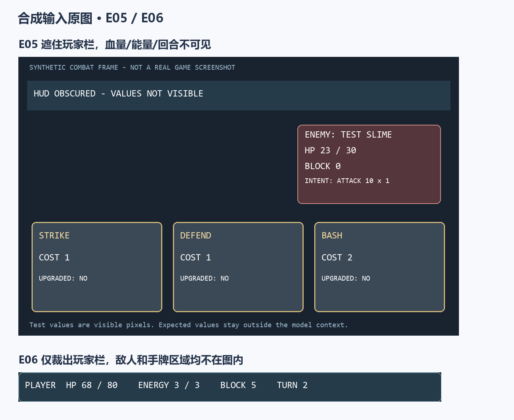
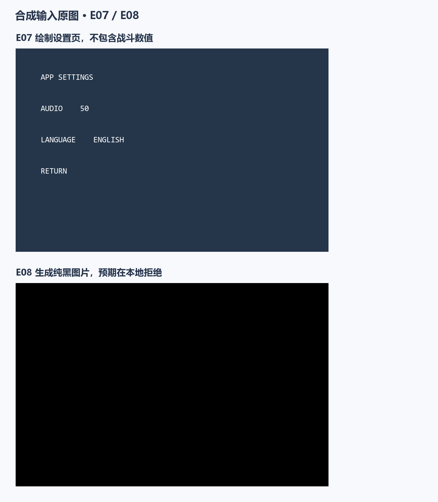
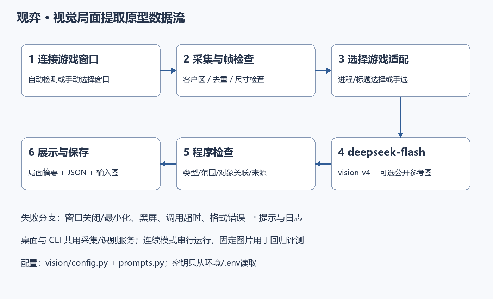
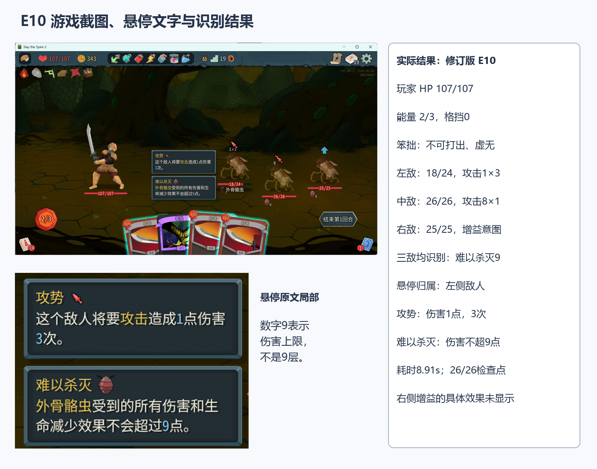
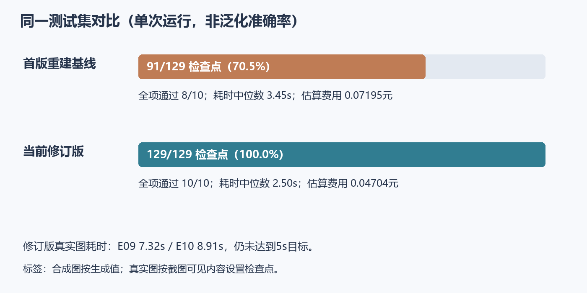

# 实验7：个人软件核心AI能力原型设计与开发

## 学习通提交说明

- **提交平台：** 只向学习通对应的作业上传一份PDF文件。
- **文件命名：** 班级-学号-姓名-实验7-个人软件核心AI能力原型设计与开发.pdf。
- **PDF内容：** 核心AI能力说明、可运行原型、测试集与基线对比、两周迭代、阶段演示和实验小结，附仓库链接与Commit。
- **截止时间：** 以学习通作业设置为准。

## 1. 实验目的

- 围绕个人软件的核心价值，根据实际需要选择LLM、RAG、工具调用或Agent/Harness，形成端到端AI原型。
- 用输入输出要求、代表性样例和适合本项目的指标判断原型是否真正解决用户问题。
- 通过两周迭代形成可演示、可测试、可继续集成的核心AI能力。

## 2. 实验内容

### 2.1 核心价值与AI用例

- 说明原型面向哪类用户、在什么时刻被调用、相比基础功能带来什么可观察价值。
- 提出价值假设和成功标准，例如任务能否完成、结果是否正确或有用、引用是否完整、是否节省时间或减少用户操作；只选择与本项目有关的指标。
- 本次原型只选择一项最核心的AI能力作为重点，说明暂不实现哪些相关功能以及原因。

### 2.2 输入输出要求与评测集

- 给出输入内容、数据来源和使用前提，规定输出格式、必要字段及失败反馈，并说明哪些结果由程序检查、哪些需要人工判断。
- 结合实验2的验收条件构造测试样例，覆盖正常输入、信息不足和超出能力范围的情况，写明期望结果、必要要点或判断规则；适用时可沿用实验5、6的样例。
- 为评测样例设置统一编号并保存为独立文件，使不同版本能够使用同一批输入重复测试。

### 2.3 原型架构与技术组合

- 绘制原型的数据流图或流程图，标出输入、实际采用的模型、检索或工具、结果检查与输出，以及准备与基础软件连接的位置；本次不要求完成整个软件的集成。
- 说明技术组合的选择理由，可以只采用模型调用，不要求同时使用RAG、工具调用和Agent，也不限制开发框架或技术栈。
- 将模型名称、Prompt和影响结果的主要参数集中放入配置文件或配置模块，避免分散写在多处代码中，便于后续替换和比较；密钥不得写入代码或提交到仓库。

### 2.4 端到端主链路实现

- 实现“用户输入—必要的预处理—AI处理—结果检查—展示或保存”的端到端链路，实际调用模型并展示结果，不能用固定回答或静态页面代替。
- 处理模型调用超时、输出不符合要求等情况；采用RAG、工具或Agent时，补充资料不足、工具错误或达到执行上限等相关分支，返回明确提示。
- 保存关键中间结果和错误信息，使一次运行失败后能够判断具体问题出现在哪个步骤。

### 2.5 原型评测与基线比较

- 对不少于10个样例运行评测，记录输出、人工判断、错误类型、响应时间及可获取的Token数或调用次数；收费接口补充实际或估算费用，本地模型注明无接口调用费用。
- 选择无AI方法、直接调用模型或初版原型作为比较基准，即基线，说明选择理由和两种方案的差异。使用相同输入和判断规则对比，分析至少一个边界样例或实际失败，不要求人为制造缺陷。
- 汇总已达到和未达到的成功标准，展示正常流程、边界处理和当前限制。

### 2.6 两周迭代与下一步

- 第1周完成可运行初版和基线评测，第2周根据测试结果和阶段反馈完成修订版；分别记录任务、Commit、结果和变化。
- 对初版和修订版运行同一测试集，记录软件版本、模型、Prompt和主要配置的变化，如实说明改进、无明显变化或退化；阶段演示注明使用的版本与反馈处理情况。
- 按影响程度排列遗留问题，制定集成任务、修复顺序和验收方法；在个人GitHub/Gitee仓库保存原型、配置样例、测试集和运行说明，报告注明路径及两个版本的Commit或Tag。

## 3. 操作记录

### 3.1 核心价值与本次范围

**项目定位**：观弈面向离散决策游戏；《杀戮尖塔2》是首个适配对象，后续保留PVZ等游戏的独立适配空间。
本实验重点实现**从游戏窗口采集画面并提取结构化局面**。正常使用时先连接游戏窗口，再单次或连续采集；
保存的截图用于反复比较同一局面，减少手工录入血量、能量、手牌和敌人状态的步骤。

我希望画面识别能为后续建议与复盘提供输入，同时保留看不清的字段，方便对照原图检查。
本次设定的目标是固定检查点通过率不低于90%，正常输入能完成识别，信息不足时不填默认值，无效输入有明确反馈；
响应时间沿用实验2提出的5秒目标。

**窗口采集已接入本次原型。** 程序枚举窗口并读取进程名；只发现一个已支持的游戏窗口时自动关联，
存在多个候选或无法自动确定时手动选择。已配置STS2与PVZ的窗口发现规则，PVZ的局面语义适配仍未实现。
连接只指关联窗口句柄，不注入进程、不读取游戏内存。

可以先“采集预览”，确认目标画面后“采集并识别”，也可以设置1—300秒间隔连续识别。
连续模式在本次任务完成后再等待设定间隔，不让请求重叠；像素完全相同时跳过请求，点击暂停/停止后不再发起新任务。
只读取目标窗口客户区，不包含外侧桌面。窗口关闭、最小化或采集失败时给出原因并停止连续模式，不自动切换其他窗口。

本次先完成识别与结果展示，自动操作、动作决策和长期记忆放在后续阶段。
PVZ还需要单独设计局面字段和采样时机。当前视觉页与手工录入、规则基线、RAG和复盘Agent并列，识别结果不会自动触发操作。

### 3.2 输入输出与固定测试集

正常输入是所选游戏窗口的实时客户区画面，由Windows窗口绘制接口取得像素。
为重复测试，也支持导入PNG/JPEG/WebP/BMP图片；图片最多20 MB、4000万像素，至少64×64。
预处理纠正朝向、去除图片元数据、最长边缩至1920，并拒绝黑屏/白屏。当前状态只取自本次像素，不读游戏内存、存档或对局日志。
STS2适配可附加公开的4种敌人、8种状态参考图，**只提供身份与外形**，不补当前血量、攻击数值或行动表。

| 输出部分 | 必要内容与约束 |
| --- | --- |
| 场景与玩家 | scene、turn；player含hp/max_hp、energy/max_energy、block |
| 手牌与敌人 | hand记录名称/费用/升级；enemies按画面从左到右记录血量、格挡、意图及单次伤害/次数 |
| 增减益与悬停 | statuses记录名称与可见数值；tooltips保留标题、原文、所属对象和敌人索引 |
| 失败与证据 | 状态、错误码、原因/处理建议、原始正文、用量/耗时/估算费用、输入哈希与配置版本 |

未知数值用null；未知区域与明确空数组区分。程序检查JSON、字段、类型、范围、血量关系、悬停索引与规则来源。
读数、图标匹配和悬停归属需要对照原图核对；JSON通过检查并不代表内容一定正确。
“难以杀灭9”表示伤害上限，不能一律称为9层；笨拙的不可打出/虚无来自明确规则资料，标注rules_source和normalizations。

**固定数据集**：`evaluation/exp7/manifest.json`统一编号，`cases/E01—E10.json`逐例保存期望字段和SHA-256，
`inputs/`保存两版共用图片。E01—E08是程序绘制的合成/边界图，E09—E10是我实际游玩时截取的两张画面。
合成图按生成时写入的数值设置期望结果，真实图按原图中的可见内容设置检查点。

**合成图的来源**：这些图不是游戏截图，也不是让图像生成模型画的。
`scripts/vision_demo.py`用Pillow绘制简化的血量栏、敌人信息框和三张卡牌，生成基础战斗图；
`scripts/build_exp7_evalset.py`再按以下步骤得到八个测试输入，生成值同时作为评分依据：

| 编号 | 具体生成方式 |
| --- | --- |
| E01 | 基础图：HP 68/80、能量3/3、格挡5、回合2，三张牌费用1/1/2，敌人攻击10×1 |
| E02 | 在基础图上重画玩家栏，将血量改为10/80、能量改为0/3、格挡改为0 |
| E03 | 将第一张牌改为WHIRLWIND，费用文字改为X |
| E04 | 将敌人意图文字从ATTACK 10 x 1改为ATTACK 2 x 3 |
| E05 | 用实色矩形遮住玩家栏，覆盖成“HUD OBSCURED”，测试看不到时是否保留null |
| E06 | 只裁出基础图的玩家状态栏，手牌和敌人区域均不在图内 |
| E07 | 单独绘制设置页文字APP SETTINGS、音量、语言和返回按钮 |
| E08 | 生成一张1000×650的纯黑图片，测试无效画面的本地拒绝 |

合成图便于单独改变一个条件，检查数字和边界处理；真实游戏中的字体、背景、动画和遮挡更复杂，所以我另外加入E09、E10实图。
每两例排成一张大图，便于直接读出测试数字。



图1　十个样例的编号与类型概览。合成图的可读版本见下方图1-1至图1-4，真实图E10另见图3。


图1-1　E01-E02：基础战斗与零能量/低血量。



图1-2　E03-E04：X费用与多段攻击。



图1-3　E05-E06：遮挡玩家栏与仅保留玩家栏；E06保留原图比例。



图1-4　E07-E08：非战斗设置页与纯黑无效输入。

E09是三敌人战斗截图，检查0格挡、单次攻击、笨拙规则和难以杀灭9；
E10增加悬停详情，检查“难以杀灭”的说明、数值9以及它与左侧敌人的关联。

两版按标签文件中的129个检查点评分，覆盖主要字段；字段缺失与明确返回null分开处理。标签、路径和旧运行记录均不发送给模型。

### 3.3 原型架构与集中配置



图2　游戏窗口采集到结果保存的主链路。已识别的窗口可按进程/标题元信息选择对应适配；
导入图片时自动模式检查图片内可见标题。识别与标题检查共享总等待预算，手动选择仍保留。

我选择**视觉模型提取＋参考图＋程序校验**。这一步主要解决画面读数，因此没有再增加Agent规划或文本RAG。
参考图辅助认名，悬停文字优先于模糊图标；通用通信层与游戏适配分开。

| 模块 | 实际职责 |
| --- | --- |
| `capture/windows.py`、`app/window_vision_service.py` | 窗口/进程元信息检测、客户区采集、输入快照与像素去重 |
| `vision/images.py`、`game_detection.py` | 输入预处理、图片模式按可见标题选择适配 |
| `vision/prompts.py`、`profiles.py` | 结构化提取说明、STS2显示约定及资料来源 |
| `vision/schema.py` | 格式/数值检查、增减益和悬停关联、摘要 |
| `app/vision_service.py` | 模型调用、有界等待、错误与中间结果保存 |
| `ui/vision_tab.py`、`cli.py` | 桌面第六页与命令行，均调用同一服务 |

模型与参数集中在`guanyi/vision/config.py`，Prompt集中在`prompts.py`和游戏适配模块；
`.env.example`只含配置占位，真实密钥仍从环境或被Git忽略的`.env`读取。

| 项目 | 首版重建基线 | 当前修订版 |
| --- | --- | --- |
| 模型调用名 | deepseek-flash | deepseek-flash |
| Prompt | vision-v1历史说明重建 | vision-v4 |
| 输出预算 | 2500 token | 4096 token |
| 深度思考 | 不显式指定，沿服务默认 | 显式disabled |
| 游戏资料 | 无；通用提取 | 可见标题检查＋可选12张身份参考图 |
| 状态与悬停 | 无专门字段 | statuses、tooltips及关联检查 |
| 共同限制 | 温度0、总等待60秒、最多2次网络重试 | 同左，自动模式含标题请求 |

我按首版提示词和参数恢复了基线，版本名为`baseline-v1-reconstructed`。
两版共用图片有效性与公共Schema检查，因此黑屏拒绝不计作修订提升。
两版配置快照与源码哈希保存在`evaluation/exp7/versions/`。

### 3.4 主链路、失败处理与阶段演示

**正常链路**：检测并关联游戏窗口（或手动选择）→ 采集客户区画面 → 本地校验/预览 → 后台请求视觉模型 → 解析检查 → 显示与保存。
连续模式重复“采集—识别”步骤，相同画面跳过请求；固定截图导入保留为测试入口。
识别过程中界面可切换，按钮防止重复并发；新任务失败时清空旧结果，避免旧答案被误认作本次成功。
记录含输入尺寸/哈希、Prompt版本、适配、参考来源、模型名、输出与错误、token、费用及耗时。

| 失败类型 | 实际处理与证据 |
| --- | --- |
| 窗口关闭/最小化/句柄变化 | 拒绝采集并停止连续任务，不更换目标窗口 |
| 窗口绘制超时 | 停止等待，保留后台采集锁；前次未结束时禁止堆积采集线程 |
| 图片损坏/黑屏/范围超限 | 本地拒绝，说明原因，尚未请求模型 |
| 模型调用失败 | 区分鉴权、余额、限流、网络与超时，给出可采取动作 |
| 输出预算耗尽 | output_limit，说明输出/推理token及预算；不再泛称“检查密钥” |
| JSON或字段不合格 | invalid_observation，保留原始回答，不采用该局面 |
| 超时 | 停止等待，不采用晚到结果；无法保证远端取消，可能仍计费 |
| 信息不足 | 保留null或partial/unrecognized；ok只代表结构有效，不代表识别正确 |

**实际失败复核**：11月10日早先8份失败记录均为`finish_reason=length`，输出2500 token全部为推理，答案正文为空。
改为关闭深度思考并调整预算后，同图得到了结构化结果。另外曾把“难以杀灭”的甲壳图标误识别为力量，
又曾因通用模式未加载规则而出现“笨拙费用1”；通过外形参考、对象位置与标题适配处理，原失败记录保留，未改写。



图3　E10游戏截图、悬停窗口局部与模型输出摘录。
读出左侧攻势1×3、难以杀灭9；其余敌人的图标与数值分别读取，不把悬停详情复制给同名敌人。

**阶段演示版本**：vision-v4当前工作目录版。以E10从截图输入到结果保存完成真实调用，输出原件为
`evaluation/exp7/results/revised-E10.json`。界面交互另外用固定返回的测试模型验证，避免反复调试按钮时产生接口费用。
我在实测时发现了“错误原因不清楚、笨拙费用1、悬停与小图标漏识别”等问题，随后据此修订并增加了回归测试。

**窗口采集验证**：我另建测试窗口显示E10固定画面，使用真实Windows接口取得1920×1124客户区，
逐像素与显示源图比较一致，再请求真实模型，读到107/107血量、2/3能量以及左侧悬停说明。
测试窗口最小化或关闭时采集被拒绝。连续流程用本地测试模型验证不重叠、相同画面跳过和停止行为。
这些结果验证采集接口和识别服务的衔接；游戏自身渲染器的兼容性还需要在实际运行的游戏中测试。

初次把测试窗口中的图片缩至1200宽时，曾把2能量读成3。改为保留原图尺寸并处理采集线程DPI后，本次复测读数正确。
这也说明采集像素正确与模型读数正确应分开检查。完整窗口采集结果位于`evaluation/exp7/results/window-capture-native.json`。

**后台方案参考**：我查看了本地MAA的PC连接配置及MaaFramework实现，采集同样采用PrintWindow。
其中“最小化后台”通过透明、点击穿透和不激活恢复来维持绘制，并非普通最小化下总能读到新画面。
本轮借鉴了采集线程DPI隔离处理；伪最小化和键鼠注入尚未接入观弈，当前最小化窗口会明确停止。
参考说明见`docs/窗口采集-MAA参考.md`。

### 3.5 十例同集对比与结果分析

2026-11-10对两版重新运行相同的10例，每例每版一次，结果逐例落盘`evaluation/exp7/results/`。
评分脚本把输出与固定标签逐项比较。合成图的标签来自生成参数，真实图的标签取自截图。
下面的“通过”表示该例检查点全部通过；E08黑屏的预期行为是本地拒绝。

| 样例 | 基线检查点 | 修订检查点 | 基线/修订耗时（秒） |
| --- | --- | --- | --- |
| E01 | 13/13 | 13/13 | 3.39 / 2.73 |
| E02 | 13/13 | 13/13 | 3.61 / 2.42 |
| E03 | 13/13 | 13/13 | 2.65 / 2.21 |
| E04 | 13/13 | 13/13 | 3.01 / 2.39 |
| E05 | 13/13 | 13/13 | 3.50 / 2.35 |
| E06 | 8/8 | 8/8 | 3.91 / 2.58 |
| E07 | 4/4 | 4/4 | 1.52 / 2.58 |
| E08 | 1/1（正确拒绝） | 1/1（正确拒绝） | 0.009 / 0.010 |
| E09 | 13/25 | 25/25 | 24.12 / 7.32 |
| E10 | 0/26（答案为空） | 26/26 | 26.09 / 8.91 |



图4　两版在同一测试集上的检查点与样例通过情况。

| 汇总项 | 基线 | 修订版 |
| --- | --- | --- |
| 固定检查点通过 | 91/129，70.5% | 129/129，100% |
| 全项通过样例 | 8/10 | 10/10 |
| 耗时中位数 | 3.45秒 | 2.50秒 |
| 最长耗时 | 26.09秒 | 8.91秒 |
| 总token（含标题检查） | 17,146 | 26,823 |
| 网络尝试数 | 9 | 18（含9次标题检查） |
| 费用估算合计 | 0.07195元 | 0.04704元 |

**错误与边界分析**：E09基线主要漏掉0格挡、无乘号的单次攻击与状态字段；E10再次出现推理2500 token耗尽、正文为空。
E05和E06没有补齐遮挡内容，符合“不猜”的要求。E07两版都正确拒绝输出战斗数值，但修订版耗时由1.52秒增至2.58秒，
自动标题检查增加了一次调用，因此并非每个样例都变快。

修订版增加了标题检查和参考图，输入token更多，但减少了较长推理，本次费用估算反而较低。
两版合计约0.11899元，按接口返回用量和项目单价表计算；缓存命中也会影响结果，实际扣费以服务账单为准。

这次达到了90%的固定检查点目标，也完成了未知值保留和错误记录，
但**两张真实图分别用时7.32秒和8.91秒，仍超过5秒目标**。
真实图只有同一战斗的两张，且已经用于修改提示词，后续需要用不同敌人、分辨率和新截图继续测试。
另外，114个自动化用例全部通过，其中4个检查评分脚本，19个检查窗口采集及界面调度；这些测试主要验证程序行为。

### 3.6 两周迭代记录与后续任务

| 阶段 | 任务与实际结果 | 版本依据 |
| --- | --- | --- |
| 第1周：11月3—9日 | 11月3日完成图片导入、识别、检查、展示与保存；合成图11/11项一致，约2.88秒，先完成单图验证 | vision-v1；运行记录`vision-66d008…b89d` |
| 第2周：11月10—16日（进行中） | 11月10日根据真实截图反馈修订空答案诊断、适配、状态图标与悬停；建立固定十例并比较两版，随后接入窗口检测、单次/连续采集与停止控制 | 当前vision-v4；配置快照与源码SHA-256 |

第1周先跑通单图流程，第2周根据实测问题修订，并在11月10日统一用十个样例比较两版。

| 版本 | Commit / Tag |
| --- | --- |
| 首版基线配置 |  |
| 修订版 |  |

| 优先级 | 遗留问题与下一步验收 |
| --- | --- |
| P1 | 补至少5张新截图，覆盖不同敌人、遮挡和状态，逐项记录误识别 |
| P1 | 降低真实图延迟：比较手选适配与自动标题、按需参考图，再统计真实图P50/P95，不只报告一次最快值 |
| P1 | 在实际游戏渲染器中测试已接入的窗口采集：检查窗口化、无边框、遮挡与DPI缩放；记录黑屏和停帧 |
| P2 | 改善连续采集：比较像素去重与局面变化检测；研究可选伪最小化，并验证窗口样式能完整恢复 |
| P2 | 扩大状态参考但避免全部257图同时入上下文；测相似图标混淆和对象归属错误 |
| P3 | 定义通用观察接口，再单独设计PVZ状态/采样适配；保留现有STS2适配作为首个实现 |

### 3.7 代码、证据与复现

仓库：https://github.com/wmbrhbhdzr/guanyi-agent。
版本记录见3.6，配置快照和源码哈希保存在`evaluation/exp7/versions/`。

| 编号 | 路径与用途 |
| --- | --- |
| 代码1 | `guanyi/capture/`、`guanyi/vision/`、`app/window_vision_service.py`、`app/vision_service.py`、`ui/vision_tab.py`：核心原型 |
| 配置1 | `guanyi/vision/config.py`；`evaluation/exp7/versions/`两版参数/Prompt快照与哈希 |
| 数据1 | `evaluation/exp7/manifest.json`、`inputs/`、`cases/`：固定样例和模型外评分依据 |
| 日志1 | `evaluation/exp7/results/baseline-E01—E10.json`：基线结果与逐项评分 |
| 日志2 | `evaluation/exp7/results/revised-E01—E10.json`、`summary.json`：修订结果与汇总 |
| 测试1 | `tests/test_vision.py`、`tests/test_vision_eval.py`及已有测试；本轮114例通过 |
| 说明1 | `docs/视觉识别-运行说明.md`、`docs/视觉识别-开发记录.md`、`evaluation/exp7/README.md` |

```powershell
# 启动桌面“游戏画面识别”页
.\.venv\Scripts\python.exe -m guanyi.ui

# 仅列出窗口；windows --hwnd <句柄> 默认只采集，加 --recognize 再请求模型
.\.venv\Scripts\python.exe -m guanyi.cli windows --list

# 固定样例复测，可指定适配跳过自动标题检查
.\.venv\Scripts\python.exe -m guanyi.cli vision --image evaluation/exp7/inputs/E10.png --game sts2

# 只汇总已有评测，不调用模型；加 --online 才实际收费运行未完成项
.\.venv\Scripts\python.exe scripts\run_exp7_eval.py

# 离线自动化测试
.\.venv\Scripts\python.exe scripts\run_tests.py
```

## 4. 实验小结

这次我先用截图跑通了画面识别、检查、展示和保存，并根据实际游玩中遇到的问题补上了状态图标和悬停识别。
同一测试集的检查点由91/129提高到129/129，但真实图仍超过5秒目标，样例范围也较小。
本次进一步接入窗口检测、客户区采集和可调间隔的连续识别，支持暂停、停止与相同画面跳过。
下一步重点检查不同游戏渲染模式下的采集兼容性，并用新画面测试识别效果与延迟，为后续建议和复盘提供更稳定的输入。
